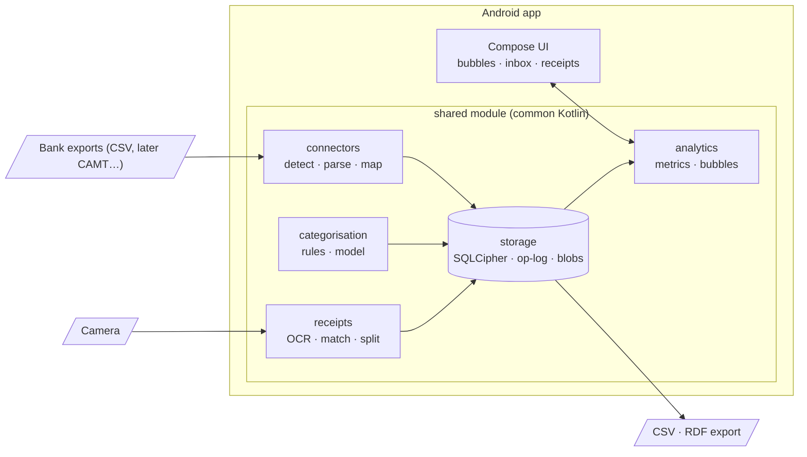

# Cashflow — Design

How Cashflow is built. Reasons for the big choices are in [DECISIONS.md](DECISIONS.md); the plan is in [ROADMAP.md](ROADMAP.md).

## Rules that always hold

1. **Money is never a floating-point number.** Amounts are `Long` minor units plus an ISO 4217 currency code; RDF exports use `xsd:decimal`.
2. **Imports are deterministic.** The same file gives the same transaction IDs on every device.
3. **Every write goes through the operation log**, in the same database transaction as the table change.
4. **No network access without an explicit user action**, and every access is logged locally.

## Stack

| Area | Choice |
|---|---|
| Language | Kotlin 2.x |
| UI | Compose Multiplatform (Android first; desktop and iOS later) |
| Build | JetBrains Amper; Gradle Kotlin DSL as fallback |
| Database | SQLite encrypted with SQLCipher, via SQLDelight or Room KMP (decided in P0) |
| Libraries | kotlinx-serialization, kotlinx-datetime, kaml (YAML), Koin |
| Camera / OCR | CameraX; ML Kit text recognition to start, PaddleOCR via ONNX Runtime later |
| ML | ONNX Runtime on the device; models trained in a Python workbench (`ml/`) |
| Tooling | Python 3.13: connector reference interpreter and golden tests (`tools/`) |

## Architecture



```
shared/        common code: domain, storage, connectors, categorisation, analytics, receipts
android-app/   Compose UI, import via share sheet / file picker, camera
desktop-app/   later: Compose Desktop
ml/            later: Python workbench for training and exporting models
```

The UI stays thin. Domain logic lives in `shared/` and is unit-tested without Android.

## Storage

* One SQLite database per profile, encrypted with SQLCipher, WAL mode. Key in the Android Keystore, optionally wrapped by a passphrase.
* Main tables: `accounts`, `transactions`, `splits`, `categories`, `category_assignments`, `rules`, `tags`, `source_files`, `source_records`, `import_runs`, `documents`, `blobs`, `op_log`, `settings`.
* `op_log` gives undo, an audit trail and later the sync feed.
* Receipt images are encrypted files addressed by their hash.

## Identity and de-duplication

| Entity | Identifier |
|---|---|
| User-created entities (rules, categories, receipts, …) | UUIDv7 (time-ordered) |
| Imported transactions | UUIDv8, SHA-256 name-based, from the fingerprint |
| Accounts found by import | UUIDv8 from the IBAN or provider account id |
| RDF export | `urn:uuid:<uuid>` |

**Fingerprint:** SHA-256 over these fields, joined by U+001F:

```
account id │ booking date │ value date │ direction │ amount │ currency │ counterparty IBAN │
UPPER(collapsed counterparty name) │ UPPER(collapsed remittance info) │ end-to-end id │ external id │ occurrence
```

* `occurrence` counts identical rows within one file, so two identical purchases on the same day stay two transactions.
* `status` is not part of it, so a pending row keeps its identity when it becomes booked.
* The reference implementation is `fingerprint_base` and `uuid8` in [`tools/connector_ref.py`](../tools/connector_ref.py); the Kotlin code must match it.

## Import pipeline

1. Detect the format (header columns, file name) → ask the user if unsure, remember per account.
2. Decode and parse with the connector → canonical records + raw row (provenance).
3. Validate fields; compute fingerprints; skip known transactions; replace matching pending rows.
4. Show a preview; on confirm, write everything in **one** database transaction.
5. Categorise: user rules → model → default rules. User decisions are never overwritten.

## Connectors

* **Declarative YAML definitions** for tabular exports: [`connectors/`](../connectors/). Data, not code: easy to review and safe to run.
* Native parsers for open standards (camt.053, MT940) later.
* Each definition has synthetic fixtures with a golden `expected.json`. The Python reference interpreter checks them in CI; the Kotlin engine must produce the same output.

## Data model

The [ontology](../ontology/) (OWL 2, SKOS categories, SHACL shapes, PROV-O provenance) is the shared vocabulary. The app stores data relationally using the same terms and exports RDF at the boundary. Core today: accounts, transactions, money, splits, categories, provenance. Receipts and tax are added when built.

* Amounts are non-negative; `direction` (debit/credit) carries the sign.
* Transfers between own accounts are `InternalTransfer`s and never count as spending.
* If a transaction has splits, analytics use the splits.
* Categories have a kind on the top level: Expense, Income, Savings, Transfer.

## Metric definitions

Let an **item** be a transaction without splits, or a split. For item *i* with amount *a* ≥ 0:

* signed spend *s(i)* = +*a* for debits, −*a* for credits;
* category *c(i)* = the split's category, else the transaction's category, else none;
* kind *k(i)* = the kind of the top-level ancestor of *c(i)*.

Items of internal transfers are excluded from everything below.

| Metric | Definition |
|---|---|
| **Spend(P, C)** | Σ *s(i)* over items booked in period *P*, with *c(i)* in the subtree of *C* and *k(i)* = Expense. Refunds reduce spend. |
| **Uncategorised spend(P)** | Σ *a* over uncategorised debits in *P*. |
| **Income(P)** | Σ −*s(i)* over items with *k(i)* = Income, plus uncategorised credits. |
| **Savings(P)** | Σ *s(i)* over items with *k(i)* = Savings. |
| **Net cash flow(P)** | Σ credits − Σ debits over all non-transfer items. |
| **Savings rate(P)** | (Income − spend − uncategorised spend) / Income. |

**Week** = ISO 8601 week (Monday–Sunday); **month** = calendar month. The SPARQL queries in [`ontology/queries/`](../ontology/queries/) implement Spend for the example data.

## Bubbles

* Packed circles: top-level category → subcategory → merchant. Area ∝ amount (radius ∝ √amount). Categories under 1 % go into "Other"; uncategorised spend is its own bubble that links to the inbox.
* Bubbles keep their identity (category notation) when the period changes and animate between periods.
* Stable, colour-blind-safe colour per top-level category; never red/green only.
* Every chart has a table alternative.

## Machine learning

* **On the device first.** Cloud services only as opt-in, per request, with the user's own key and a local log.
* **Categorisation:** normalised merchant + remittance text + amount features → small multilingual embedding model + classifier (ONNX), learning from the user's corrections. Rules always win over the model.
* **Receipts:** OCR → parse total, date, merchant and lines → check that the numbers add up → otherwise ask the user.
* Models are downloaded on demand and verified by hash; their licences must allow redistribution.

## Privacy and security

* Encrypted database and files; app lock with biometrics/PIN.
* No telemetry, ads or trackers. Network only for opt-in features, each logged.
* Untrusted input: size and time limits for imports; parsers are fuzz-tested.
* Export everything; delete everything.
* Never commit real financial data — fixtures are synthetic.

## Later

* **Sync** phone ↔ laptop without a server: an encrypted backup file first, then LAN sync (Ktor + mDNS + pinned device keys) or iroh. Decided in P6.
* **Knowledge Graph Manager backend:** optionally publish the ontology, shapes and data (as Turtle) to a self-hosted KGM (Apache Jena + Spring Boot) for server-side SPARQL and validation. One-way mirror; the local database stays the source of truth.
