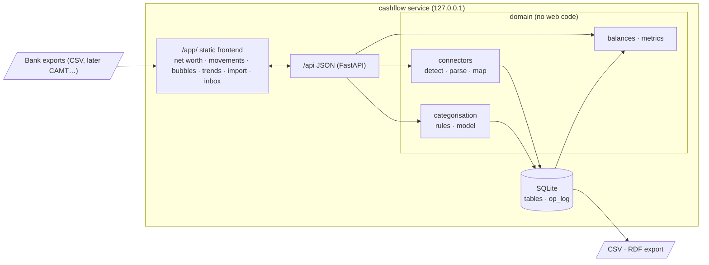

# Cashflow — Design

How Cashflow is built. Reasons for the big choices are in [DECISIONS.md](DECISIONS.md); the plan is in [ROADMAP.md](ROADMAP.md).

## Rules that always hold

1. **Money is never a floating-point number.** Amounts are integer minor units plus an ISO 4217 currency code (`Decimal` only while parsing); RDF exports use `xsd:decimal`.
2. **Imports are deterministic.** The same file gives the same transaction IDs on every device.
3. **Every write goes through the operation log**, in the same database transaction as the table change.
4. **No network access without an explicit user action**, and every access is logged locally.

## Stack

| Area | Choice |
|---|---|
| Language | Python 3.13, managed with uv (package layout `cashflow/src/cashflow`) |
| Service | FastAPI + Uvicorn; settings with pydantic-settings (`CASHFLOW_*` env vars, `.env`) |
| Database | SQLite via SQLAlchemy 2.0 |
| Frontend | Static files served by FastAPI under `/app/`: plain JavaScript, no build step; Apache ECharts (lines, bars, donut) and d3-hierarchy (bubble layout), vendored, no CDN |
| Libraries | PyYAML + jsonschema (connectors), rdflib (categories, RDF export) |
| Tests | pytest, httpx (`ASGITransport`), pytest-cov; ruff |

## Architecture



```
cashflow/                  uv project
  pyproject.toml           scripts: dev (reload), prod
  src/cashflow/
    app.py                 app factory; /api router, / → /app/, static UI
    run_dev.py run_prod.py
    connectors/            engine.py (interpreter), registry.py (load, detect), conformance.py
    db.py                  SQLAlchemy models
    service/api.py         HTTP endpoints
    service/importer.py    import pipeline
    balances.py metrics.py
    utils/config.py        settings
    resources/ui/          index.html, assets/ (app.css, js/, vendor/)
  test/                    unit/, e2e/, support/
```

Endpoints stay thin: domain modules (connectors, importer, balances, metrics) don't import FastAPI and are unit-tested directly. The frontend talks only to `/api` (all `fetch` calls in `assets/js/api.js`); FastAPI documents the API at `/docs`.

## Storage

* One SQLite database in the data directory (`CASHFLOW_DATA_DIR`, default `~/.local/share/cashflow`), never inside the repository. WAL mode.
* Main tables: `accounts`, `transactions`, `splits`, `categories`, `category_assignments`, `rules`, `tags`, `balance_observations`, `source_files`, `source_records`, `import_runs`, `op_log`, `settings`, plus `balance_daily` (derived, see Balances).
* `op_log` gives undo, an audit trail and later the sync feed.
* No database encryption yet (see [DECISIONS.md](DECISIONS.md) #2).

## Identity and de-duplication

| Entity | Identifier |
|---|---|
| User-created entities (rules, categories, receipts, …) | UUIDv7 (time-ordered) |
| Imported transactions | UUIDv8, SHA-256 name-based, from the fingerprint |
| Accounts found by import | UUIDv8 from the IBAN or provider account id |
| RDF export | `urn:uuid:<uuid>` |

**Fingerprint:** SHA-256 over these fields, joined by U+001F:

```
account id │ booking date │ value date │ direction │ amount │ currency │ counterparty IBAN │
UPPER(collapsed counterparty name) │ UPPER(collapsed remittance info) │ end-to-end id │ external id │ occurrence
```

* `occurrence` counts identical rows within one file, so two identical purchases on the same day stay two transactions.
* `status` is not part of it, so a pending row keeps its identity when it becomes booked.
* Implemented by `fingerprint_base` and `uuid8` in the connector engine; any later app must match it (the golden fixtures check this).

## Import pipeline

1. The file is uploaded to `POST /api/imports`. Detect the format (header columns, file name) → ask the user if unsure, remember per account.
2. Decode and parse with the connector → canonical records + raw row (provenance).
3. Validate fields; compute fingerprints; skip known transactions; replace matching pending rows.
4. Show a preview; on confirm, write everything in **one** database transaction.
5. Categorise: user rules → model → default rules. User decisions are never overwritten.

## Connectors

* **Declarative YAML definitions** for tabular exports: [`connectors/`](../connectors/). Data, not code: easy to review and safe to run.
* **Code connectors** for formats the YAML can't describe, behind the same interface: so far the Trade Republic PDF statement (word positions via PyMuPDF; every row checked against the running balance, totals against the account overview). Native parsers for open standards (camt.053, MT940) later.
* Each definition has synthetic fixtures with a golden `expected.json`; the service's tests check that the engine reproduces them.

## Data model

The [ontology](../ontology/) (OWL 2, SKOS categories, SHACL shapes, PROV-O provenance) is the shared vocabulary. The app stores data relationally using the same terms and exports RDF at the boundary. Core today: accounts, transactions, money, splits, categories, provenance. Receipts and tax are added when built.

* Amounts are non-negative; `direction` (debit/credit) carries the sign.
* Transfers between own accounts are `InternalTransfer`s and never count as spending.
* If a transaction has splits, analytics use the splits.
* Categories have a kind on the top level: Expense, Income, Savings, Transfer.

## Metric definitions

Let an **item** be a transaction without splits, or a split. For item *i* with amount *a* ≥ 0:

* signed spend *s(i)* = +*a* for debits, −*a* for credits;
* category *c(i)* = the split's category, else the transaction's category, else none;
* kind *k(i)* = the kind of the top-level ancestor of *c(i)*.

Items of internal transfers are excluded from everything below.

| Metric | Definition |
|---|---|
| **Spend(P, C)** | Σ *s(i)* over items booked in period *P*, with *c(i)* in the subtree of *C* and *k(i)* = Expense. Refunds reduce spend. |
| **Uncategorised spend(P)** | Σ *a* over uncategorised debits in *P*. |
| **Income(P)** | Σ −*s(i)* over items with *k(i)* = Income, plus uncategorised credits. |
| **Savings(P)** | Σ *s(i)* over items with *k(i)* = Savings. |
| **Net cash flow(P)** | Σ credits − Σ debits over all non-transfer items. |
| **Savings rate(P)** | (Income − spend − uncategorised spend) / Income. |
| **Money in(P)** | Σ *a* over credits in *P*. |
| **Money out(P)** | Σ *a* over debits in *P*. |
| **Transfers(P)** | Σ *a* over the debit legs of internal transfers in *P* (the one metric that uses them; shown grey). |
| **Balance(A, t)** | Balance of account *A* at the end of day *t* (see Balances). |
| **Liquid net worth(t)** | Σ Balance(A, t) over all *liquid* accounts *A*, converted to the base currency. |

**Liquid accounts** are checking, savings, payment-service (PayPal), credit-card (usually negative), broker cash and cash-wallet accounts. The user can exclude an account. Securities positions are not part of liquid net worth: buying securities is money *out* with kind Savings ("Saving & investing").

**Check:** for a period in which every liquid account is fully imported, Liquid net worth(end) − Liquid net worth(start) = Money in − Money out. A difference points to a missing import or a wrong balance and is shown as a warning.

**Week** = ISO 8601 week (Monday–Sunday); **month** = calendar month.

## Balances

* **Anchors:** balances from export files (preamble or CAMT closing balances, already read by the connectors as `balances`) are stored in `balance_observations`. Where an export has none, the user enters an opening balance for the account.
* **Computation:** Balance(A, t) = nearest anchor + Σ signed amounts of booked transactions between the anchor and *t*. Anchors before and after *t* must agree; if they don't, the gap is flagged (usually a missing import).
* **Speed:** `balance_daily(account, day, balance)` is derived from the transactions and anchors and updated incrementally after each import or edit, so the net-worth chart and donut need no recomputation.
* Pending transactions are not part of balances; they are shown separately.

## Views

Style: dark theme, large numbers, a horizontal period strip (… Aug · Sep · **Oct**) for single periods and range tabs (1D · 1W · 1M · 1Y · Max) for line charts, similar to Trade Republic. Every chart has a table alternative; colours are stable, colour-blind-safe and never red/green only.

1. **Net worth.** Line chart of Liquid net worth(t) for the selected range, with a draggable marker that shows date and value. Clicking a date opens a **donut chart** of Balance(A, t) per liquid account (negative balances such as a credit card are listed below the donut). Clicking a slice opens the account: its balance line and transactions.
2. **Movements over time.** For longer ranges: Money in and Money out per week, month or year (bars, or lines for ranges above two years), with the net result; transfers as a grey series that can be hidden.
3. **Movement bubbles** for one period (day, week, month, year):
   * Level 1: *Income*, *Spending*, *Saving & investing* and a grey *Transfers* bubble; area ∝ amount (radius ∝ √amount).
   * Click → categories of that kind → subcategories → merchants → transactions (a breadcrumb leads back). Under 1 % share goes into "Other"; uncategorised items get their own bubble that links to the inbox.
   * Below the bubbles: a list with colour dot, name, amount and share of the parent.
   * Bubbles keep their identity (category notation) when the period changes and animate to the new sizes.
4. **Trends.** Line charts for net worth, income and spending over months and years, using the same range tabs as the net-worth chart.

## Machine learning

* **Local first.** Cloud services only as opt-in, per request, with the user's own key and a local log.
* **Categorisation:** normalised merchant + remittance text + amount features → a scikit-learn classifier at first, a small multilingual embedding model later, learning from the user's corrections. Rules always win over the model.
* Models are trained and stored in the data directory; downloaded models are verified by hash and their licences must allow redistribution.

## Privacy and security

* The service binds to `127.0.0.1` only; no accounts, no telemetry, no CDN: all frontend libraries are vendored.
* Network only for opt-in features, each logged.
* Untrusted input: upload size limit and parse time limits; parsers are tested with malformed files.
* Export everything; delete everything (one data directory).
* Never commit real financial data — fixtures are synthetic.

## Later

* **Phone app:** Kotlin Multiplatform + Compose, Android first, SQLCipher with the key in the Android Keystore ([DECISIONS.md](DECISIONS.md) #8). The service's domain logic and the connector fixtures are its specification.
* **Receipts:** photo or PDF upload → OCR (e.g. PaddleOCR) → total, date, merchant and lines → match to the payment → split. Images stored encrypted, addressed by their hash.
* **Sync** between devices without a server: an encrypted backup file first, then LAN sync.
* **Knowledge Graph Manager backend:** optionally publish the ontology, shapes and data (as Turtle) to a self-hosted KGM (Apache Jena + Spring Boot) for server-side SPARQL and validation. One-way mirror; the local database stays the source of truth.
