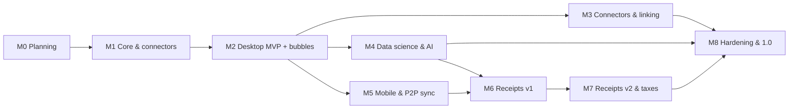

# Cashflow — Milestone roadmap

This roadmap orders the features of the [Lastenheft](LASTENHEFT.md) and the requirements of the [Pflichtenheft](SPECIFICATION.md) into milestones. Each milestone has a goal, the features it delivers, concrete deliverables, exit criteria (Definition of Done) and a **learning focus**: the technologies you get hands-on with, linked to the [Rust learning path](learning/RUST.md).

* Milestones are gated by **exit criteria**, not by dates.
* Sizes are rough relative effort for one part-time developer: **S** ≈ 2 weeks, **M** ≈ 1 month, **L** ≈ 2 months, **XL** ≈ 3+ months.
* Status: ✅ done · 🟡 in progress · ⚪ planned. Feature status is tracked in the Lastenheft.

## Overview

| | Milestone | Theme | Release | Size | Status |
|---|---|---|---|---|---|
| **M0** | Planning & foundations | Lastenheft, Pflichtenheft, ontology v0.1, connector language, spikes | — | M | 🟡 |
| **M1** | Core & first connectors | Headless Rust core, encrypted storage, import pipeline, command line | v0.1 (CLI) | L | ⚪ |
| **M2** | Desktop MVP: see your spending | Desktop app, categorisation v1, **bubble views** | v0.2 alpha | L | ⚪ |
| **M3** | More connectors & linking | 12+ connectors, mapping wizard, transfers, PayPal/card/Amazon linking, plugins | v0.3 | L | ⚪ |
| **M4** | Data science & AI categorisation | On-device AI (embeddings, typed decision models), subscriptions, anomalies, forecasts | v0.4 | L | ⚪ |
| **M5** | Mobile & P2P sync | Android/iOS apps, pairing, peer-to-peer sync, app lock | v0.5 beta | XL | ⚪ |
| **M6** | Receipts v1 | Capture, on-device OCR, line items, matching, splitting, e-invoices | v0.6 | XL | ⚪ |
| **M7** | Receipts v2 & taxes | Larger local models, opt-in cloud, product analytics, tax reports | v0.7 | L | ⚪ |
| **M8** | Hardening & 1.0 | Security, accessibility, performance, docs, distribution | **v1.0** | M | ⚪ |

M3, M4 and M5 can run in parallel once M2 is done. Spending analytics, the main focus, arrive early in M2 and grow in M4.

---

## M0 — Planning & foundations 🟡

**Goal:** agree on *what* to build and *how*, settle the risky technical questions with small experiments, and set up the repository so every later change is checked automatically.

**Delivers:** planning artefacts only (no Lastenheft features).

**Requirements (Pflichtenheft):** SEC-03.

| Deliverable | Where | Status |
|---|---|---|
| Lastenheft (features, constraints, quality, acceptance) + this roadmap + Rust learning path | PR #1 | 🟡 in review |
| Pflichtenheft (technical specification) + architecture decision records | PR #2 | 🟡 in review |
| Ontology v0.1 (OWL, SKOS categories, SHACL rules, examples) | PR #2 | 🟡 in review |
| Connector language v0.1 (schema, reference interpreter, first sample files) + validation tooling + CI | PR #2 | 🟡 in review |
| Technical spikes SP-1 … SP-9, each with a short written result | later PRs | ⚪ |
| Repository scaffolding: Cargo workspace, Tauri app skeleton, Python ML workbench | later PR | ⚪ |
| Threat model v0 | later PR | ⚪ |

**Spikes** (time-boxed throw-away prototypes):

| ID | Question | Pass criterion |
|---|---|---|
| SP-1 | Tauri 2 on all five platforms | A Svelte page calls a Rust function on Windows, macOS, Linux, Android and iOS; desktop + Android built in CI. |
| SP-2 | Encrypted SQLite everywhere | SQLite with SQLCipher opens and writes on desktop, Android and iOS; key protected by the OS keystore. |
| SP-3 | Peer-to-peer connectivity | iroh 1.x: laptop ↔ phone connect on the same Wi-Fi (mDNS) and across networks via relay. |
| SP-4 | AI models on mobile | ONNX Runtime runs a small multilingual embedding model and a typed decision model (e.g. Laya) on Android and iOS; latency and app size measured. |
| SP-5 | OCR on the device | PP-OCRv5 mobile reads 10 synthetic German receipts on desktop and Android. |
| SP-6 | Local vision-language model | A ~4 B vision model extracts receipt data on a laptop via llama.cpp. |
| SP-7 | Bubble performance | Animated bubble chart with 200 bubbles at 60 fps on desktop and ≥ 30 fps on an Android phone. |
| SP-8 | Plugins | WebAssembly components run on desktop, Android and iOS. |
| SP-9 | camt.053 | Public camt.053 samples (several versions) parse correctly. |

**Exit criteria:** PR #1 and PR #2 merged · all spikes reported · architecture decisions accepted or revised · scaffolding in place.

**Learning focus:** Rust setup and basics ([stage 0–1](learning/RUST.md#stage-0--setup-1-day)) · semantic web basics (OWL, SKOS, SHACL, SPARQL) · GitHub Actions.

---

## M1 — Core & first connectors ⚪

**Goal:** a headless, well-tested Rust core that imports real exports into an encrypted database without duplicates and with full traceability, plus a command line for daily use.

**Delivers:** LF-IMP-01, LF-IMP-02, LF-IMP-03, LF-IMP-04, LF-IMP-05, LF-IMP-06, LF-IMP-07 · LF-DAT-01, LF-DAT-02, LF-DAT-03 · LF-SYN-01 · LF-PRV-01, LF-PRV-02, LF-PRV-03 · LF-EXP-01 · LF-APP-01.

**Requirements (Pflichtenheft):** D-01, D-02, D-05, D-06, D-07, D-08, ACC-01, ACC-02, CON-01, CON-02, CON-03, CON-04, CON-06, CON-07, CON-08, CON-10, CON-11, CON-16 (part), CON-17, SEC-01, SEC-04, SEC-05, SEC-07, SEC-10, EXP-01, EXP-05, APP-08.

**Deliverables**

* Rust crates for the domain model, encrypted storage with an operation log, connectors (detection, declarative engine, camt.053 parser) and RDF export; the `cashflow` command line (import with preview, export, backup/restore).
* Connectors for Sparkasse, DKB, PayPal and camt.053, checked against real exports (locally).
* Fuzzing for every parser; property-based tests for money, dates and duplicate detection.
* Ontology published on GitHub Pages.

**Exit criteria**

* The Rust connector engine produces exactly the expected output for every sample file.
* Re-importing overlapping exports creates zero duplicates; pending → booked works.
* The RDF export passes the ontology's validation rules; database → RDF → database is lossless.
* 10 000 rows import in ≤ 2 s on a laptop; fuzzers ran ≥ 1 h each without findings.
* Backup → wipe → restore gives identical data.

**Learning focus:** idiomatic Rust: ownership, `Result`/`?`, traits, `serde`, `csv`, `quick-xml`, `rusqlite`, `proptest`, `cargo-fuzz` ([stage 2–3](learning/RUST.md#stage-2--build-real-programs-36-weeks)). The best exercise: port the Python reference interpreter of the connector language to Rust.

---

## M2 — Desktop MVP: see your spending ⚪

**Goal:** the first usable app. Import exports, get them categorised, and *see* where the money goes, in bubbles per week and month.

**Delivers:** LF-CAT-01, LF-CAT-02, LF-CAT-03, LF-CAT-04, LF-CAT-05, LF-CAT-06, LF-CAT-07 · LF-ANA-01, LF-ANA-02, LF-ANA-03, LF-ANA-04, LF-ANA-05, LF-ANA-06 · LF-EXP-02 · LF-APP-02, LF-APP-03, LF-APP-04, LF-APP-05 · LF-PLT-01.

**Requirements (Pflichtenheft):** ACC-04, CAT-01, CAT-02, CAT-03, CAT-05, CAT-06, CAT-07, CAT-08, ANA-01, ANA-02, ANA-03, ANA-04, ANA-05, ANA-07, ANA-15, ANA-20, EXP-03, APP-01, APP-02, APP-03, APP-06, APP-09.

**Deliverables**

* Tauri 2 desktop app (Windows, macOS, Linux).
* Screens: onboarding, import centre, transactions with split editor, review inbox, rules, category editor, **period bubbles**, **bubble timeline**, trends.
* Merchant-name cleanup, rule engine, default rules; documented metric definitions; English and German UI; undo.

**Exit criteria**

* First import → bubbles in under 5 minutes, observed with 3 test users.
* Weekly review works with the keyboard only.
* With 100 000 synthetic transactions: app ready in ≤ 1.5 s, period switch ≤ 0.1 s.
* The app's numbers equal the reference queries on the same data.
* Signed alpha builds for all desktop platforms.

**Learning focus:** Svelte 5, D3 layouts and transitions, Tauri commands and events, typed Rust ↔ TypeScript bindings ([stage 4](learning/RUST.md#stage-4--async-ffi-and-the-app-shell-ongoing)).

---

## M3 — More connectors & linking ⚪

**Goal:** cover the whole financial picture and stop double counting.

**Delivers:** LF-IMP-08, LF-IMP-09, LF-IMP-10, LF-IMP-11, LF-IMP-12, LF-IMP-13, LF-IMP-14, LF-IMP-15, LF-IMP-16, LF-IMP-17.

**Requirements (Pflichtenheft):** ACC-03, CON-05, CON-09, CON-12, CON-14, CON-15, CON-16 (rest), CON-18, CON-19, CON-22.

**Deliverables**

* Connectors for ING, comdirect, VR banks, Commerzbank, Deutsche Bank, Postbank, N26, Revolut, Wise, bunq, Trade Republic, Scalable Capital, Amex, Barclays, DKB Visa; MT940.
* Mapping wizard for unknown CSV files; anonymiser; contributor guide for connector authors.
* Detection of transfers between own accounts; linking of PayPal, card and Amazon payments to bank entries.
* Plugin host (WebAssembly) with the Amazon order-history export as first plugin.

**Exit criteria**

* ≥ 12 connectors, ≥ 6 of them checked against real exports.
* Linking: ≥ 98 % precision and ≥ 90 % recall on synthetic and own data; no double counting in combined data.

**Learning focus:** WebAssembly components, fuzzy matching and record linkage, running an open-source contribution process.

---

## M4 — Data science & AI categorisation ⚪

**Goal:** smart analytics: categorisation that learns, subscriptions, anomalies, forecasts, and full access for your own data science.

**Delivers:** LF-CAT-08, LF-CAT-09, LF-CAT-10 · LF-ANA-07, LF-ANA-08, LF-ANA-09, LF-ANA-10, LF-ANA-11, LF-ANA-12 · LF-PRV-04.

**Requirements (Pflichtenheft):** CAT-04, CAT-09, CAT-10, CAT-11, CAT-12, ANA-06, ANA-08, ANA-09, ANA-10, ANA-11, ANA-12, ANA-13, ANA-16, ANA-17, SEC-06, SEC-09, EXP-02, EXP-04.

**Deliverables**

* Python ML workbench: synthetic transaction generator, baselines, benchmark reports, model export to ONNX.
* On-device categorisation: model registry (downloads pinned by hash and licence), embedding model + classifier that learns from corrections, calibrated confidence.
* **Model bake-off**: embedding + kNN/logistic regression vs. typed decision models (e.g. open-weight Laya) on the device; optional opt-in cloud classification (e.g. TypeSafe Jev or other AI APIs) for new merchants and uncertain cases, with consent, minimal data and a local log.
* Subscriptions dashboard, comparison mode, anomaly cards, forecast, heatmap, Sankey, merchant statistics; Parquet export and example notebook; SPARQL console.

**Exit criteria**

* ≥ 90 % of automatically applied categories correct, covering ≥ 70 % of transactions, after 300 corrections (synthetic benchmark + own data, reported locally).
* Bake-off report published; the chosen on-device model adds ≤ 50 ms per transaction on a laptop.
* Subscription detection ≥ 0.9 precision and recall on synthetic data; forecast bands hit their nominal coverage in back-tests.
* With cloud classification switched off, no request is possible (test).

**Learning focus:** ONNX Runtime from Rust (`ort`), embeddings, calibration, active learning, time-series methods, Python with uv/polars/marimo.

---

## M5 — Mobile & P2P sync ⚪

**Goal:** Cashflow on the phone, in sync with the laptop, without any server.

**Delivers:** LF-SYN-02, LF-SYN-03, LF-SYN-04, LF-SYN-05, LF-SYN-06 · LF-PRV-05, LF-PRV-06 · LF-APP-06 · LF-PLT-02.

**Requirements (Pflichtenheft):** D-04, ACC-05, SYN-01, SYN-02, SYN-03, SYN-04, SYN-05, SYN-06, SYN-07, SYN-08, SYN-10, SEC-02, SEC-11, APP-05, APP-10.

**Deliverables**

* Android and iOS apps (bubbles, inbox, quick actions).
* Device keys, QR pairing, peer-to-peer sync with iroh (LAN discovery, optional relay), operation-log replication, receipt image sync.
* App lock; network-transparency screen.
* Simulation tests for sync (random message orders, network splits).

**Exit criteria**

* Pairing in under a minute; 1 000 changes sync over Wi-Fi in ≤ 2 s.
* 10 000 random simulation runs all end in identical data on all devices.
* Importing the same file on both devices yields no duplicates.
* Beta builds on Android (APK/F-Droid) and iOS (TestFlight).

**Learning focus:** async Rust and Tokio, QUIC networking with iroh, clocks and conflict resolution (HLC, CRDT ideas), mobile development with Tauri plus small Kotlin/Swift plugins.

---

## M6 — Receipts v1 ⚪

**Goal:** photograph a receipt, get its line items on the device, and have the bank payment split automatically.

**Delivers:** LF-REC-01, LF-REC-02, LF-REC-03, LF-REC-04, LF-REC-05.

**Requirements (Pflichtenheft):** D-03, REC-01, REC-02, REC-03, REC-04, REC-05, REC-06, REC-07, REC-08, REC-09, REC-12, REC-15.

**Deliverables**

* Camera capture with edge detection and perspective correction.
* Pipeline: image cleanup → OCR (PP-OCRv5) → structure (line classifier + small local language model with JSON output) → sum checks → review UI.
* Matching to bank payments and automatic splitting by line-item categories.
* E-invoice reader (ZUGFeRD/Factur-X, XRechnung), PDF text extraction; Amazon orders as itemised documents.
* Synthetic German receipt generator and benchmark.

**Exit criteria**

* On typical supermarket receipts: total ≥ 98 %, date ≥ 97 %, shop ≥ 95 % correct; line items F1 ≥ 0.90.
* OCR step ≤ 5 s on a mid-range phone.
* ≥ 90 % of receipts matched to the right payment in the end-to-end test.

**Learning focus:** image processing, OCR pipelines, structured output from language models, e-invoice standards, synthetic datasets.

---

## M7 — Receipts v2 & taxes ⚪

**Goal:** handle the hard receipts, understand prices over time, and turn everything into a clean tax-year package.

**Delivers:** LF-REC-06, LF-REC-07, LF-REC-08 · LF-TAX-01, LF-TAX-02, LF-TAX-03, LF-TAX-04, LF-TAX-05 · LF-ANA-13.

**Requirements (Pflichtenheft):** CON-13, ANA-14, REC-10, REC-11, REC-13, REC-14, TAX-01, TAX-02, TAX-03, TAX-04, TAX-05, TAX-06.

**Deliverables**

* Vision-language model tier (llama.cpp) with model bake-off; processing on the paired laptop.
* Opt-in cloud extraction with consent preview and log.
* Product names normalised; price history and personal inflation rate; warranty reminders.
* Tax categories, tagging rules and suggestions, completeness list, tax-year report (CSV/Excel/PDF) and receipt ZIP; rule-pack format with a template.

**Exit criteria**

* The larger-model tier measurably improves results on hard receipts.
* The tax-year scenario (S-06) works end-to-end with own data.
* Every opt-in cloud request shows a preview and is logged.

**Learning focus:** vision-language models and quantisation, privacy-friendly AI UX, report generation.

---

## M8 — Hardening & 1.0 ⚪

**Goal:** a trustworthy 1.0 that others can install and rely on.

**Delivers:** LF-ANA-14 · LF-APP-07 · LF-PLT-03.

**Requirements (Pflichtenheft):** ANA-18, SEC-08, APP-04, APP-07, APP-11.

**Deliverables**

* Security review and `SECURITY.md`; threat-model update.
* Accessibility audit (WCAG 2.2 AA) and fixes.
* All quality targets (LQ-01 … LQ-09) verified on reference devices.
* User guide, connector-author guide, ontology documentation site.
* Signed releases: GitHub, Flathub, F-Droid, App Store/TestFlight.
* Ontology 1.0.0 freeze.

**Exit criteria:** every *Must* feature ✅ in the Lastenheft · all quality targets verified · v1.0.0 tagged.

**Learning focus:** release engineering (signing, notarisation, reproducible builds), accessibility, security reviews.

---

## After 1.0

**Delivers:** LF-IMP-18 · LF-ANA-15 · LF-SYN-07 · LF-EXP-03, LF-EXP-04.

**Requirements (Pflichtenheft):** CON-20, CON-21, ANA-19, SYN-09, EXP-06, KGM-01, KGM-02, KGM-03, KGM-04, KGM-05, KGM-06, KGM-07, KGM-08, KGM-09, KGM-10, KGM-11, KGM-12.

Live bank access (FinTS/PSD2), budgets, more devices and a household mode, plain-text accounting exports; possibly community tax rule packs; an optional Knowledge Graph Manager backend (low priority, Pflichtenheft §6.11).

---

## Feature → milestone index

| Milestone | Lastenheft features |
|---|---|
| M1 | LF-IMP-01, LF-IMP-02, LF-IMP-03, LF-IMP-04, LF-IMP-05, LF-IMP-06, LF-IMP-07, LF-DAT-01, LF-DAT-02, LF-DAT-03, LF-SYN-01, LF-PRV-01, LF-PRV-02, LF-PRV-03, LF-EXP-01, LF-APP-01 |
| M2 | LF-CAT-01, LF-CAT-02, LF-CAT-03, LF-CAT-04, LF-CAT-05, LF-CAT-06, LF-CAT-07, LF-ANA-01, LF-ANA-02, LF-ANA-03, LF-ANA-04, LF-ANA-05, LF-ANA-06, LF-EXP-02, LF-APP-02, LF-APP-03, LF-APP-04, LF-APP-05, LF-PLT-01 |
| M3 | LF-IMP-08, LF-IMP-09, LF-IMP-10, LF-IMP-11, LF-IMP-12, LF-IMP-13, LF-IMP-14, LF-IMP-15, LF-IMP-16, LF-IMP-17 |
| M4 | LF-CAT-08, LF-CAT-09, LF-CAT-10, LF-ANA-07, LF-ANA-08, LF-ANA-09, LF-ANA-10, LF-ANA-11, LF-ANA-12, LF-PRV-04 |
| M5 | LF-SYN-02, LF-SYN-03, LF-SYN-04, LF-SYN-05, LF-SYN-06, LF-PRV-05, LF-PRV-06, LF-APP-06, LF-PLT-02 |
| M6 | LF-REC-01, LF-REC-02, LF-REC-03, LF-REC-04, LF-REC-05 |
| M7 | LF-REC-06, LF-REC-07, LF-REC-08, LF-TAX-01, LF-TAX-02, LF-TAX-03, LF-TAX-04, LF-TAX-05, LF-ANA-13 |
| M8 | LF-ANA-14, LF-APP-07, LF-PLT-03 |
| post | LF-IMP-18, LF-ANA-15, LF-SYN-07, LF-EXP-03, LF-EXP-04 |

## Requirement → milestone index (Pflichtenheft)

Generated from the requirement tables of the [Pflichtenheft](SPECIFICATION.md); `tools/validate.py` checks that it stays consistent.

| Milestone | Requirements |
|---|---|
| M0 | SEC-03 |
| M1 | D-01, D-02, D-05, D-06, D-07, D-08, ACC-01, ACC-02, CON-01, CON-02, CON-03, CON-04, CON-06, CON-07, CON-08, CON-10, CON-11, CON-16 (part), CON-17, SEC-01, SEC-04, SEC-05, SEC-07, SEC-10, EXP-01, EXP-05, APP-08 |
| M2 | ACC-04, CAT-01, CAT-02, CAT-03, CAT-05, CAT-06, CAT-07, CAT-08, ANA-01, ANA-02, ANA-03, ANA-04, ANA-05, ANA-07, ANA-15, ANA-20, EXP-03, APP-01, APP-02, APP-03, APP-06, APP-09 |
| M3 | ACC-03, CON-05, CON-09, CON-12, CON-14, CON-15, CON-16 (rest), CON-18, CON-19, CON-22 |
| M4 | CAT-04, CAT-09, CAT-10, CAT-11, CAT-12, ANA-06, ANA-08, ANA-09, ANA-10, ANA-11, ANA-12, ANA-13, ANA-16, ANA-17, SEC-06, SEC-09, EXP-02, EXP-04 |
| M5 | D-04, ACC-05, SYN-01, SYN-02, SYN-03, SYN-04, SYN-05, SYN-06, SYN-07, SYN-08, SYN-10, SEC-02, SEC-11, APP-05, APP-10 |
| M6 | D-03, REC-01, REC-02, REC-03, REC-04, REC-05, REC-06, REC-07, REC-08, REC-09, REC-12, REC-15 |
| M7 | CON-13, ANA-14, REC-10, REC-11, REC-13, REC-14, TAX-01, TAX-02, TAX-03, TAX-04, TAX-05, TAX-06 |
| M8 | ANA-18, SEC-08, APP-04, APP-07, APP-11 |
| post | CON-20, CON-21, ANA-19, SYN-09, EXP-06, KGM-01, KGM-02, KGM-03, KGM-04, KGM-05, KGM-06, KGM-07, KGM-08, KGM-09, KGM-10, KGM-11, KGM-12 |
| won't | CON-23, TAX-07, KGM-13 |
