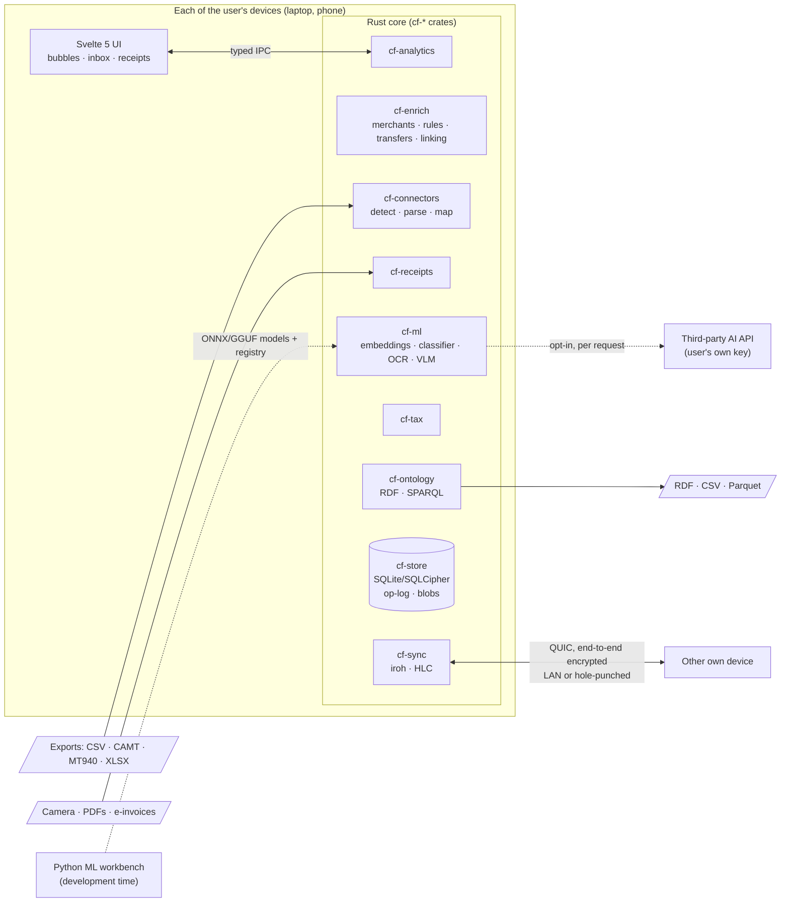
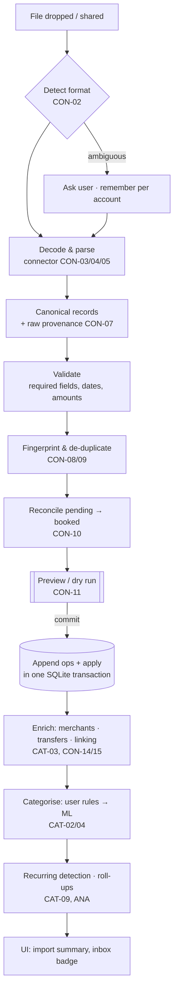
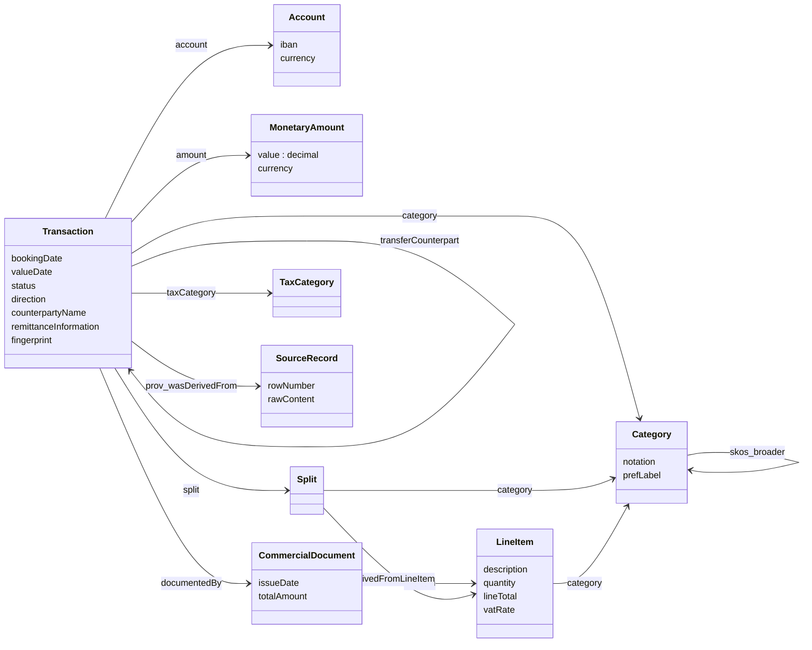
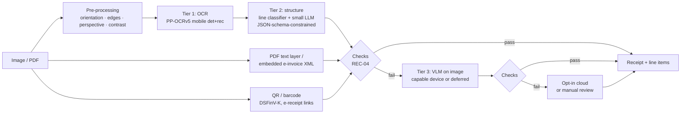

# Cashflow — Pflichtenheft (Software Requirements Specification)

| | |
|---|---|
| **Document** | Pflichtenheft / Software Requirements Specification (SRS) |
| **Version** | 0.1.0 — draft for review |
| **Date** | 2026-10-19 |
| **Milestone** | M0 (Foundations) — see [ROADMAP.md](ROADMAP.md) |
| **Answers** | [Lastenheft](LASTENHEFT.md) (features `LF-*`, tracked there) |
| **Related** | [Roadmap](ROADMAP.md) · [Architecture decisions](adr/) · [Ontology](../ontology/) · [Connectors](../connectors/) |

---

## Contents

0. [About this document](#0-about-this-document)
1. [Goals (Zielbestimmung)](#1-goals-zielbestimmung)
2. [Product use (Produkteinsatz)](#2-product-use-produkteinsatz)
3. [Product environment (Produktumgebung)](#3-product-environment-produktumgebung)
4. [Architecture](#4-architecture)
5. [Data model & ontology (Produktdaten)](#5-data-model--ontology-produktdaten)
6. [Functional requirements (Produktfunktionen)](#6-functional-requirements-produktfunktionen)
7. [Quality requirements (Qualitätsanforderungen)](#7-quality-requirements-qualitätsanforderungen)
8. [Machine-learning specification](#8-machine-learning-specification)
9. [Peer-to-peer sync specification](#9-peer-to-peer-sync-specification)
10. [User interface (Benutzungsoberfläche)](#10-user-interface-benutzungsoberfläche)
11. [Test & quality assurance](#11-test--quality-assurance)
12. [Development, build & release](#12-development-build--release)
13. [Risks](#13-risks)
14. [Open questions](#14-open-questions)
15. [Glossary](#15-glossary)
16. [References](#16-references)
17. [Traceability: Lastenheft → Pflichtenheft](#17-traceability-lastenheft--pflichtenheft)

---

## 0. About this document

This Pflichtenheft describes **how** Cashflow will be built. It answers the [Lastenheft](LASTENHEFT.md), which states **what** the user wants: every Lastenheft feature (`LF-*`) is refined here into one or more technical, testable requirements, and the matrix in §17 links them. Feature status is tracked in the Lastenheft; this document changes when the technical solution changes.

**Requirement IDs.** Each requirement has an ID `AREA-NN`, a priority and a target milestone:

| Area | Meaning | Area | Meaning |
|---|---|---|---|
| `ACC` | Accounts | `SYN` | Device sync |
| `CON` | Connectors & import | `SEC` | Security & privacy |
| `CAT` | Enrichment & categorisation | `EXP` | Export, backup, interoperability |
| `ANA` | Analytics & visualisation | `APP` | General app behaviour, UX, i18n |
| `REC` | Receipts & documents | `NFR` | Non-functional (quality) requirements |
| `TAX` | Tax tagging | | |

**Priority** follows MoSCoW: **M**ust, **S**hould, **C**ould, **W**on't (in 1.0). **Milestones** `M0`–`M8` are defined in [ROADMAP.md](ROADMAP.md); `post` means after 1.0.

The key words MUST, SHOULD and MAY are used as described in RFC 2119/8174.

**Changing this document.** Changes go through pull requests. Architecturally significant changes also need an ADR in [`docs/adr/`](adr/). The document version follows semantic versioning (minor: new or changed requirements; patch: clarifications).

---

## 1. Goals (Zielbestimmung)

### 1.1 Vision

> **Cashflow is a privacy-first, open-source, local-first personal finance analyser.** It imports the exports of any bank, card or payment provider, translates them into one well-defined ontology, and answers the question that matters most — *where does my money go?* — visually, as **bubbles per week and month**, backed by solid data science. Receipts captured with the phone are broken down into **line items** by on-device machine learning, which also helps to collect **tax-relevant** expenses. There is **no server**: data lives on the user's devices and syncs **peer-to-peer**.

### 1.2 Must criteria (Musskriterien)

1. **Connectors** translate exports of German banks, neobanks/brokers, PayPal, Amazon and card issuers into the internal ontology, idempotently and with full provenance.
2. An **OWL 2 ontology** with **SHACL** shapes is the canonical data model; all data can be exported losslessly as RDF.
3. **Categorisation** works automatically (rules + on-device ML) and learns from user corrections.
4. **Bubble-based spending analytics** per week and month with drill-down, comparison against typical periods, trends and recurring-payment detection.
5. **One codebase** for Windows, macOS, Linux, Android and iOS.
6. **Peer-to-peer sync** between the user's devices with no central server run by the project.
7. **Privacy by default:** local processing, encryption at rest, no telemetry, no network access without an explicit user action.

### 1.3 Should and could criteria (Wunschkriterien)

* **Receipts** (the "bonus" in the brief): capture, on-device OCR and line-item extraction, matching to transactions, automatic splitting. *Should, planned for 1.0.*
* **Generic tax tagging:** user-defined tax categories, tax-year report and receipt bundle export. *Should, planned for 1.0.*
* **Data-science extras:** anomaly detection, forecasting, a personal inflation index from receipt line items. *Should/could.*
* Natural-language questions, a SPARQL console, Python notebook access. *Could.*
* Live bank access (FinTS/HBCI, PSD2), budgets, household mode. *Post-1.0.*

### 1.4 Out of scope (Abgrenzungskriterien)

* A backend or cloud service operated by the project; user accounts or sign-up.
* Payment initiation or any write access to bank accounts.
* Storing online-banking credentials; screen scraping of banking websites.
* Portfolio tracking (security positions, performance). Broker accounts are modelled only through their cash flows.
* Tax advice, tax calculation or filing (e.g. ELSTER). No jurisdiction-specific tax rules in the core.
* Double-entry bookkeeping and business accounting compliance (e.g. GoBD).
* Multiple users or households in 1.0. The architecture must not preclude them later.
* Shipping ML models whose licences forbid commercial use or redistribution.

### 1.5 Kickoff decisions (2026-10-19)

| Topic | Decision | ADR |
|---|---|---|
| Stack | Rust core, Tauri 2 shell, Svelte 5 UI. Python only in the ML workbench (development time), never at runtime. | [ADR-0001](adr/0001-application-stack.md) |
| Users | Single person, several accounts, laptop **and** phone. | — |
| Device sync | Peer-to-peer without a central server. | [ADR-0005](adr/0005-p2p-sync.md) |
| First connectors | German bank CSV exports; neobanks & brokers; PayPal, Amazon and credit cards. Live bank access after 1.0. | [ADR-0004](adr/0004-connector-architecture.md) |
| Receipt ML | On-device first; third-party services opt-in only, per request. | [ADR-0006](adr/0006-on-device-ml.md) |
| Tax | Generic, jurisdiction-agnostic. | — |
| Data model | Ontology-first (OWL 2 + SKOS + SHACL + PROV-O); relational runtime. | [ADR-0003](adr/0003-ontology-first-domain-model.md) |
| Storage | SQLite (encrypted) as system of record with an append-only operation log. | [ADR-0002](adr/0002-local-first-storage.md) |
| Licence | AGPL-3.0-or-later for code; CC BY 4.0 for ontology & taxonomy. | [ADR-0007](adr/0007-licensing.md) |
| AI categorisation | Embedding + classifier and typed decision models (e.g. open-weight Laya) on the device; hosted models (e.g. TypeSafe Jev) only as opt-in. | [ADR-0006](adr/0006-on-device-ml.md) |
| Feature tracking | Lastenheft with `LF-*` IDs and status; requirements here trace to it (§17). | — |
| Docs language | English; German domain terms in parentheses where helpful. | — |

---

## 2. Product use (Produkteinsatz)

### 2.1 Target user and persona

**Alex**, 30s, employed in Germany. Two checking accounts (Sparkasse, DKB), a credit card, PayPal, a Trade Republic account and occasionally Revolut when travelling; shops on Amazon. Alex wants to know what they spend per category without maintaining spreadsheets, can download CSV exports, cares about privacy and uses a laptop plus a phone.

### 2.2 Usage scenarios

| ID | Scenario | Flow (abridged) |
|---|---|---|
| S-01 | **First run** | Install → create local profile (optional passphrase) → drop a CSV → detected as *Sparkasse CSV-CAMT V2* → preview → import → auto-categorised → bubbles of last month. **Target: under 5 minutes.** |
| S-02 | **Weekly review** | Open app → *this week* bubbles compared with a typical week → inbox of 7 uncertain items → confirm with the keyboard → done in about 5 minutes. |
| S-03 | **Monthly import** | Download exports from 4 providers → drop all at once → formats detected, overlaps de-duplicated, PayPal and card settlements linked → summary "312 new, 41 duplicates skipped, 6 transfers linked, balances reconciled". |
| S-04 | **Supermarket receipt** | Phone camera → edge detection → on-device extraction in seconds → after the next bank import the receipt is matched automatically → transaction split into Groceries / Drugstore / Household. |
| S-05 | **Online order** | Amazon order history imported → card transactions such as "AMZN Mktp" itemised → the headphones line gets a warranty end date. |
| S-06 | **Subscription check** | Subscriptions view: 11 active subscriptions = €137/month; a price increase of a streaming service is flagged. |
| S-07 | **Tax year** | User defines tax categories ("Work equipment", "Medical", "Donations") → rules and receipt line items tag items → at year end: report plus a ZIP with all linked receipts for the tax software or adviser. |
| S-08 | **Two devices** | Phone and laptop paired once by QR code; on the same Wi-Fi they sync automatically; receipts captured on the phone appear on the laptop. |
| S-09 | **Data-science mode** | Export Parquet and analyse it in a notebook with polars/DuckDB, or query the RDF export with SPARQL. |

### 2.3 Operating conditions

* Single user; works fully offline. Network access happens only for sync, model downloads, opt-in cloud extraction and optional exchange-rate downloads, each triggered or allowed explicitly.
* Design volume: up to 30 accounts, 200 000 transactions (≈ 20 years) and 30 000 receipts per profile.
* Consumer hardware; ML features adapt to device capability (§8.1).

---

## 3. Product environment (Produktumgebung)

### 3.1 Target platforms

Minimum versions are proposals to be confirmed by the M0 spikes.

| Platform | Minimum (proposal) | Distribution |
|---|---|---|
| Windows | 10 22H2 / 11, x64 and arm64 | MSI/NSIS via GitHub Releases; winget (C) |
| macOS | 13+, Apple silicon and Intel | Notarised DMG; Homebrew cask (C) |
| Linux | x86_64/aarch64, glibc ≥ 2.35 | AppImage, .deb, Flatpak (Flathub) |
| Android | 10+ (API 29), arm64 | APK on GitHub Releases, F-Droid (reproducible build); Google Play (C) |
| iOS/iPadOS | 17+ | TestFlight/App Store, see OQ-03 |

### 3.2 Hardware assumptions

* **Desktop:** 8 GB RAM. The optional vision-language-model (VLM) tier needs 16 GB RAM or a GPU/NPU.
* **Phone:** 4 GB RAM for the OCR pipeline; 8 GB or more for the optional on-device VLM tier.
* **Storage:** app under 40 MB without models. Models are downloaded on demand: about 30 MB for OCR, up to about 3 GB for an optional VLM. Data: about 50 MB per 100 000 transactions plus about 150 KB per compressed receipt image.

### 3.3 Technology stack

Candidates marked *(evaluate)* are validated in the M0 spikes before they are adopted.

| Layer | Choice | Notes |
|---|---|---|
| Core language | **Rust** (stable) | Memory-safe and fast; compiles to every target, including WASM. |
| App shell | **Tauri 2** | Desktop and mobile from one codebase; Rust ↔ web IPC. Typed bindings via `tauri-specta` *(evaluate)*. |
| UI | **Svelte 5 + SvelteKit** (static SPA), TypeScript, Tailwind CSS 4, Bits UI/shadcn-svelte | Runes-based reactivity; small bundles. |
| Charts | **D3** (`d3-hierarchy` pack, `d3-force`, scales) rendered by Svelte | Full control of bubble layouts and animated transitions. LayerChart as a helper *(evaluate)*. |
| i18n | **Paraglide JS** (inlang) | Compile-time, type-safe messages; English and German at launch. |
| Storage | **SQLite** via `rusqlite`, encrypted with **SQLCipher** | One file per profile; WAL mode; embedded migrations. |
| Blob store | Content-addressed (BLAKE3) files, encrypted (XChaCha20-Poly1305) | Receipts, source files. |
| RDF | **Oxigraph** crates (`oxrdf`, `oxttl`, `spargebra`/`oxigraph`) | RDF export/import, SPARQL console. SHACL in CI via pySHACL; Rust SHACL via `rudof` *(evaluate)*. |
| Analytics | SQL on SQLite plus Rust; **`augurs`** for time series (MSTL/ETS forecasting, outliers, changepoints) *(evaluate)*; `arrow`/`parquet` for export | Personal-scale data needs no separate OLAP engine at runtime. |
| ML runtime | **ONNX Runtime** via `ort` (CPU, CoreML, NNAPI/XNNPACK, DirectML) for embedding and typed decision models; **llama.cpp** (GGUF) via Rust bindings for the LLM/VLM tier *(evaluate)* | See §8. |
| OCR | **PaddleOCR PP-OCRv5** mobile detection/recognition as ONNX, e.g. via the `oar-ocr` crate *(evaluate)*; Apple Vision on Apple platforms (optional) | See §8.4. |
| Sync | **iroh 1.x** (QUIC, hole punching, relays) with `iroh-mdns-address-lookup` for LAN discovery; HLC operation log | See §9. |
| Plugins | WebAssembly components (WASI 0.2) on **Wasmtime**; the Pulley interpreter where JIT is unavailable (iOS) *(evaluate)* | Sandboxed code connectors (CON-05). |
| ML workbench | Python 3.13 with **uv**, polars, scikit-learn, PyTorch, ONNX tooling, **marimo** notebooks | Development time only. |
| CI/CD | GitHub Actions; clippy, rustfmt, cargo-deny, cargo-audit, eslint, prettier, ruff; signed releases, CycloneDX SBOM | §12. |

---

## 4. Architecture

### 4.1 Overview



The UI is a thin layer over the core. All domain logic, persistence, ML inference and sync live in Rust crates that are also usable headless (CLI, tests, Python bindings).

### 4.2 Components

| Crate / package | Responsibility |
|---|---|
| `cf-domain` | Domain types (Account, Transaction, Money, Category, …) and invariants. No I/O. |
| `cf-store` | SQLite schema, migrations, repositories, operation log, blob store, encryption. |
| `cf-connectors` | Format detection, decoding, native standard parsers (CAMT, MT940), declarative-mapping engine, WASM plugin host, conformance runner. |
| `cf-enrich` | Merchant normalisation, rule engine, internal-transfer detection, cross-source linking, recurring-series detection. |
| `cf-ml` | Model registry and downloads, ONNX/llama.cpp runtimes, embeddings, categorisation classifier, cloud-provider adapters. |
| `cf-receipts` | Capture post-processing, OCR pipeline, structured extraction, validation, matching, splitting, e-invoice parsing. |
| `cf-analytics` | Metric definitions (§6.4.4), roll-ups, time-series features, anomaly detection, forecasting, Parquet export. |
| `cf-tax` | Tax categories, assignments, rule packs, tax-year reports and bundles. |
| `cf-ontology` | RDF export/import, SHACL validation hook, SPARQL console. |
| `cf-sync` | Device identity, pairing, iroh transport, version vectors, op replication, blob transfer. |
| `cf-cli` | `cashflow` command line: import, export, conformance, maintenance. |
| `cf-py` *(S)* | Python bindings (PyO3/maturin) for notebooks. |
| `app/` | Tauri 2 application (`src-tauri`) and Svelte frontend; native mobile plugins (Kotlin/Swift) where needed. |
| `ml/` | Python workbench: synthetic data, training, evaluation, model export. |

### 4.3 Import pipeline



### 4.4 Storage model

* **System of record:** one SQLite database per profile, encrypted with SQLCipher, in WAL mode.
* **Money:** `i64` minor units plus an ISO 4217 code (minor-unit exponent from the ISO table); never floating point. The RDF export converts to `xsd:decimal`.
* **Write path:** every mutation is an *operation* appended to `op_log` and applied to the tables **in the same SQLite transaction**. This gives undo (APP-06), sync (§9) and an audit trail at once, without full event sourcing.
* **Roll-ups:** `rollup_daily(account, category, day, signed_sum, count)` is maintained incrementally so that bubble views meet NFR-PERF-03.
* **Blobs:** receipt images, PDFs and source files are stored content-addressed (BLAKE3) under the app data directory, encrypted per blob with a key derived from the profile master key.
* **Key management:** a random profile master key, wrapped by the OS keystore (Keychain, Android Keystore, Windows DPAPI/Credential Manager, Secret Service) and optionally by a user passphrase (Argon2id).

Main tables (outline): `accounts`, `institutions`, `parties`, `merchants`, `merchant_aliases`, `transactions`, `splits`, `categories`, `category_assignments`, `rules`, `tags`, `documents`, `line_items`, `products`, `tax_categories`, `tax_schemes`, `source_files`, `source_records`, `import_runs`, `recurring_series`, `balance_observations`, `blobs`, `op_log`, `devices`, `model_registry`, `rollup_daily`, `settings`.

### 4.5 Ontology ↔ relational mapping

| Ontology | Relational | Notes |
|---|---|---|
| `cf:Account` + subclasses | `accounts(kind, …)` | `kind` holds the subclass local name. |
| `cf:Transaction`, `cf:InternalTransfer` | `transactions` (+ `transfer_counterpart_id`) | `InternalTransfer` = has counterpart or is flagged. |
| `cf:MonetaryAmount` | `(amount_minor, currency)` columns | Embedded value object. |
| `cf:Split` | `splits` | Stored as one LWW unit per transaction for sync (§9.4). |
| `cf:Category` / `cf:CategoryScheme` (SKOS) | `categories(notation, parent, kind, labels_json, scheme)` | Notation is the stable key. |
| `cf:CategoryAssignment` | `category_assignments` | Method, confidence, explanation. |
| `cf:CommercialDocument` + `cf:LineItem` | `documents`, `line_items` | |
| `cf:TaxCategory` | `tax_categories`, `tax_schemes` | |
| `cf:SourceFile`, `cf:SourceRecord`, `cf:ImportRun`, `cf:Connector` | `source_files`, `source_records`, `import_runs` | Connector identity as columns. |

A CI test (from M1) exports fixture databases to RDF, validates them with SHACL and re-imports them (round trip).

### 4.6 Extension points

1. **Connectors**: declarative YAML definitions and WASM components (§6.2).
2. **Tax rule packs**: declarative, jurisdiction-specific bundles (TAX-04).
3. **Model registry entries**: additional OCR/VLM/embedding models with hashes and licences (§8.1).
4. **Category schemes**: alternative or extended SKOS taxonomies.
5. **Exporters**: further output formats (EXP-06).

---

## 5. Data model & ontology (Produktdaten)

The ontology lives in [`ontology/`](../ontology/). It is licensed CC BY 4.0 and validated in CI by [`tools/validate.py`](../tools/validate.py).

### 5.1 Principles

1. **Ontology-first:** the OWL 2 ontology defines the vocabulary; database, APIs and connectors use its terms.
2. **Relational runtime:** the app does not run a triple store in its hot path. RDF is produced at the boundaries (export, validation, SPARQL console).
3. **Closed-world validation with SHACL:** OWL describes meaning (open world); SHACL shapes enforce data quality (closed world).
4. **Reuse before invention:** SKOS for taxonomies, PROV-O for provenance, alignment to schema.org and ISO 20022.
5. **Provenance everywhere:** every fact can be traced to a file, record, connector version, model or user action.

### 5.2 Modules

| Module | Key classes |
|---|---|
| Parties & accounts | `cf:Party`, `cf:Person`, `cf:Organization`, `cf:FinancialInstitution`, `cf:Merchant`, `cf:Account` → `cf:BankAccount` (`cf:CheckingAccount`, `cf:SavingsAccount`), `cf:CreditCardAccount`, `cf:PaymentServiceAccount`, `cf:BrokerageCashAccount`, `cf:CashWallet` |
| Money & payments | `cf:MonetaryAmount`, `cf:Transaction`, `cf:InternalTransfer`, `cf:Split`, `cf:Direction` {`cf:Debit`, `cf:Credit`}, `cf:TransactionStatus` {`cf:Booked`, `cf:Pending`} |
| Categorisation | `cf:Category` ⊑ `skos:Concept`, `cf:CategoryScheme`, `cf:CategoryKind`, `cf:CategoryAssignment`, `cf:AssignmentMethod` |
| Documents | `cf:CommercialDocument` → `cf:Receipt`, `cf:Invoice`, `cf:Order`; `cf:LineItem`, `cf:DeductionLine`, `cf:Product`, `cf:TaxBreakdown` |
| Tax | `cf:TaxCategory` ⊑ `skos:Concept`, `cf:TaxCategoryScheme` |
| Provenance | `cf:SourceFile`, `cf:SourceRecord`, `cf:ImportRun`, `cf:ExtractionRun`, `cf:Connector` (PROV-O subclasses) |
| Analytics helpers | `cf:RecurringSeries`, `cf:BalanceObservation` |



### 5.3 Transaction properties

| Property | Range | Card. | ISO 20022 camt.053 | Example |
|---|---|---|---|---|
| `cf:account` | `cf:Account` | 1 | `Stmt/Acct` | the Sparkasse checking account |
| `cf:bookingDate` | `xsd:date` | 1 | `Ntry/BookgDt/Dt` | 2026-10-03 |
| `cf:valueDate` | `xsd:date` | 0..1 | `Ntry/ValDt/Dt` | 2026-10-02 |
| `cf:transactionDateTime` | `xsd:dateTime` | 0..1 | — | card terminal time |
| `cf:amount` | `cf:MonetaryAmount` (≥ 0) | 1 | `Ntry/Amt` | 26.09 EUR |
| `cf:direction` | `cf:Debit` \| `cf:Credit` | 1 | `Ntry/CdtDbtInd` | debit |
| `cf:status` | `cf:Booked` \| `cf:Pending` | 0..1 | `Ntry/Sts` | booked |
| `cf:originalAmount`, `cf:exchangeRate` | amount, decimal | 0..1 | `AmtDtls/InstdAmt` | 30.00 USD, 0.8697 |
| `cf:fee` | `cf:MonetaryAmount` | 0..n | — | PayPal fee |
| `cf:counterpartyName` / `Iban` / `Bic` | string | 0..1 | `RltdPties/Cdtr\|Dbtr` | REWE Markt GmbH |
| `cf:counterparty` | `cf:Party` | 0..1 | — | normalised merchant |
| `cf:remittanceInformation` | string | 0..1 | `RmtInf/Ustrd` | REWE SAGT DANKE … |
| `cf:bookingText` | string | 0..1 | `AddtlNtryInf` | KARTENZAHLUNG |
| `cf:endToEndId`, `cf:mandateReference`, `cf:creditorId` | string | 0..1 | `Refs/EndToEndId`, `Refs/MndtId`, `Cdtr/Id` | SEPA references |
| `cf:merchantCategoryCode` | string (ISO 18245) | 0..1 | — | 5411 |
| `cf:externalId`, `cf:relatedExternalId` | string | 0..1 | `Refs/AcctSvcrRef` | PayPal transaction codes |
| `cf:category`, `cf:categoryAssignment` | category / assignment | 0..1 / 0..n | — | Groceries, by model 0.93 |
| `cf:split`, `cf:documentedBy`, `cf:transferCounterpart`, `cf:recurringSeries` | see ontology | | — | |
| `cf:taxCategory`, `cf:taxYear`, `cf:deductibleShare` | see ontology | | — | |
| `cf:fingerprint` | string (SHA-256 hex) | 0..1 | — | §5.6 |

### 5.4 Amounts, signs and currencies

* Amounts are **non-negative**; the sign is carried by `cf:direction`, as in ISO 20022 (`Amt` + `CdtDbtInd`). This avoids sign confusion between providers (CON-06).
* `cf:value` is always `xsd:decimal`; never binary floating point anywhere in the stack.
* Every account has one currency. Foreign-currency card payments keep the booked amount in the account currency plus `cf:originalAmount` and `cf:exchangeRate` when the source provides them.
* Aggregations across currencies convert to the profile's base currency (ANA-16).

### 5.5 Categories (SKOS)

* The default scheme ([`categories.ttl`](../ontology/categories.ttl)) has 15 top-level categories and 55 subcategories with English and German labels, German synonyms (`skos:altLabel`) and stable notations such as `FOOD.GROCERIES`.
* **Kinds** (`cf:categoryKind`) sit on top-level categories and are inherited: Expense, Income, Savings, Transfer. They decide how amounts enter the metrics (§6.4.4).
* "Uncategorised" is not a category; it is the absence of `cf:category`.
* **Customisation:** users add, rename, move, hide or merge categories in their own scheme layered over the default (`skos:exactMatch`/`skos:broader` links). The shipped scheme is never mutated, so updates of the default taxonomy can be merged.
* Tree constraint: at most one `skos:broader` per category (SHACL).

### 5.6 Identity and de-duplication

| Entity | Identifier |
|---|---|
| User-created entities (rules, categories, documents, …) | **UUIDv7** (RFC 9562), time-ordered for index locality. |
| Imported transactions | **UUIDv8**, name-based with SHA-256 (RFC 9562 §5.8), derived from the fingerprint, so every device computes the same ID for the same imported row (SYN-05). |
| Accounts discovered by import | UUIDv8 from the IBAN or provider account id. |
| Files and blobs | SHA-256 (provenance) and BLAKE3 (blob store). |
| RDF export | `urn:uuid:<uuid>` IRIs. |

**Fingerprint** (normative reference: `fingerprint_base` in [`tools/connector_ref.py`](../tools/connector_ref.py)): SHA-256 over the canonical fields, joined by U+001F:

```
account id │ booking date │ value date │ direction │ amount │ currency │ counterparty IBAN │
UPPER(collapsed counterparty name) │ UPPER(collapsed remittance info) │ end-to-end id │ external id │ occurrence
```

* `occurrence` counts identical canonical rows within one file (0, 1, …). Two genuinely identical purchases on the same day therefore stay two transactions, while re-importing overlapping exports yields the same fingerprints. Exports are cut by date, so both rows always appear together.
* `status` is excluded, so a row does not change identity when it goes from pending to booked with otherwise identical data.
* **Cross-format duplicates** (the same bank exported as CSV and as CAMT, with slightly different texts) are detected fuzzily (CON-09) and merged after confirmation.
* **Pending → booked:** pending rows are replaced by the booked row that matches on account, amount and counterparty within ±10 days (CON-10).

### 5.7 Provenance

Every imported transaction links via `prov:wasDerivedFrom` to its `cf:SourceRecord` (row number, raw content) inside a `cf:SourceFile` (SHA-256, name, media type) and via `prov:wasGeneratedBy` to the `cf:ImportRun` associated with the `cf:Connector` (id + version). Receipts link to their image and their `cf:ExtractionRun` (models used, on-device or not). Category assignments record the method, confidence and explanation.

### 5.8 Validation (SHACL)

[`shapes.ttl`](../ontology/shapes.ttl) enforces, among other things:

* exactly one account, booking date, amount and direction per transaction; non-negative amounts; ISO 4217 currencies; IBANs in electronic format; masked card numbers only;
* splits that add up to the transaction amount (SPARQL constraint);
* internal-transfer legs on different accounts, in opposite directions and of equal amount (warning);
* receipt line items (minus deductions) and VAT breakdowns that add up to the document total (warnings, shown in the review UI);
* categories forming a tree with stable notations and a kind on every top-level category;
* deductible shares and confidences in [0, 1].

Negative test data ([`examples/invalid/`](../ontology/examples/invalid/)) ensures each constraint actually fires.

### 5.9 Standards and alignment

| Standard | Use |
|---|---|
| OWL 2 DL, RDF 1.1, SKOS, SHACL, PROV-O | Ontology, taxonomy, validation, provenance |
| schema.org | `skos:closeMatch` alignment (MonetaryAmount, BankAccount, Invoice, Order, OrderItem, …) |
| ISO 20022 camt.052/053/054 | Canonical transaction semantics (`cf:iso20022Path` annotations) |
| ISO 4217, ISO 13616 (IBAN), ISO 9362 (BIC), ISO 18245 (MCC), ISO 3166 | Codes |
| UN/ECE Recommendation 20 | Units of measure for line items |
| EN 16931 (ZUGFeRD/Factur-X, XRechnung) | Structured invoices (REC-08) |
| RFC 9562 | UUIDv7/v8 |
| FIBO (EDM Council) | Planned alignment via SSSOM mapping set (post-1.0) |

### 5.10 Versioning and namespaces

* Ontology IRI `https://gerfr.github.io/Cashflow/ontology/cashflow`, namespace `…/cashflow#` (prefix `cf`); version IRI `…/cashflow/<semver>`. The IRIs resolve once GitHub Pages publishes the documentation (M1). A permanent w3id.org identifier is an open question (OQ-01).
* Semantic versioning: before 1.0.0 breaking changes are allowed; afterwards a major version is required for removals or meaning changes, with a migration note.
* The database schema version, sync protocol version, connector DSL version and ontology version are tracked independently.

### 5.11 Data requirements

| ID | Requirement | Prio | MS |
|---|---|---|---|
| D-01 | Transactions, documents and assignments are kept until the user deletes them. | M | M1 |
| D-02 | Raw source records are kept for audit and re-processing (setting, default on). | M | M1 |
| D-03 | Original receipt images are kept; optional automatic downscaling after N months. | S | M6 |
| D-04 | The operation log is compacted once all paired devices have acknowledged it (§9.4). | M | M5 |
| D-05 | "Delete everything" removes all data and keys (crypto-shredding of the master key). | M | M1 |
| D-06 | Domain model, database and RDF export use the terms of the Cashflow ontology (§5.2–5.3); every term used is declared and documented in English and German. | M | M1 |
| D-07 | The ontology covers categories (SKOS), documents and line items, tax tags and provenance (§5.2, §5.7). | M | M1 |
| D-08 | SHACL shapes validate all exported data; arithmetic inconsistencies (splits, receipt lines, VAT) are reported as violations or warnings (§5.8). | S | M1 |

---

## 6. Functional requirements (Produktfunktionen)

### 6.1 Accounts (ACC)

| ID | Requirement | Prio | MS |
|---|---|---|---|
| ACC-01 | Create, edit and archive accounts of every `cf:Account` subclass with institution, IBAN or masked card number, currency, display name and colour. | M | M1 |
| ACC-02 | On import, accounts are matched or created automatically from IBANs or provider account ids in the file. | M | M1 |
| ACC-03 | Balance observations from files (preamble balances, CAMT `Bal`) are stored; computed and reported balances are reconciled and gaps (missing imports) flagged. | S | M3 |
| ACC-04 | Opening balances and a balance timeline per account and across all cash accounts. | S | M2 |
| ACC-05 | Cash wallet with quick manual entry on mobile. | C | M5 |

### 6.2 Connectors & import (CON)

Connectors are a central part of Cashflow. They translate each provider's export into canonical records and from there into the ontology.

#### 6.2.1 Connector tiers

| Tier | Mechanism | For | Examples |
|---|---|---|---|
| **1 – Native standard parsers** | Rust code in `cf-connectors` | Open standards with stable schemas | ISO 20022 camt.052/053/054 (all `camt.05x.001.*` versions, namespace-agnostic), MT940/STA |
| **2 – Declarative definitions** | YAML interpreted by the engine ([DSL](../connectors/README.md), [JSON Schema](../connectors/schema/connector.schema.json)) | Tabular exports (CSV, later XLSX/JSON) | Sparkasse, DKB, ING, N26, PayPal, Revolut, … |
| **3 – Code plugins** | Sandboxed WebAssembly components (WASI 0.2), no network or file access beyond the input | Formats beyond tables: multi-file ZIPs, PDF statements, JSON with nesting | Amazon order history ZIP, PDF credit-card statements |

All tiers emit the same **canonical record** (fields listed in the JSON Schema). Tier 2 is preferred because definitions are data: easy to review, safe to share and portable to other tools.

#### 6.2.2 Requirements

| ID | Requirement | Prio | MS |
|---|---|---|---|
| CON-01 | Import by drag & drop or file picker (desktop) and share sheet or file picker (mobile): CSV/TXT, XML (CAMT), MT940/STA, XLSX (S), JSON (S), ZIP (S), PDF statements (C). | M | M1 |
| CON-02 | **Automatic format detection**: all connectors are scored against the file (header columns, XML namespace, magic bytes, filename patterns); a single confident match is used directly, otherwise the user chooses and the choice is remembered per account. | M | M1 |
| CON-03 | **Declarative connector engine** executing YAML definitions (DSL v0.1); definitions are versioned with semver and validated against the JSON Schema. | M | M1 |
| CON-04 | **Native parser** for camt.053 (also camt.052 intraday and camt.054 batch details, S); MT940 follows in M3 (catalogue §6.2.3). | M | M1 |
| CON-05 | **Code connectors** as WASM components with capability-based sandboxing. | S | M3 |
| CON-06 | **Robust parsing:** encoding detection (UTF-8 with or without BOM, Windows-1252, ISO-8859-15), delimiters and quoting, multi-line fields, locale-aware decimals (`1.234,56`, `-12,50`, `12,50-`) and dates, preambles and footers, debit/credit indicator columns. | M | M1 |
| CON-07 | **Provenance:** each transaction keeps its source file hash, row number, raw record, connector id + version and import run. | M | M1 |
| CON-08 | **Idempotent import:** re-importing the same or overlapping files never creates duplicates (fingerprints, §5.6). | M | M1 |
| CON-09 | **Fuzzy duplicate detection** across formats and providers (amount, date ±2 days, text similarity), merged after confirmation. | S | M3 |
| CON-10 | **Pending → booked reconciliation**; stale pending rows expire after a configurable time (default 14 days). | M | M1 |
| CON-11 | **Preview (dry run)** before commit: parsed rows, detected account, duplicates, per-row errors with line numbers. A commit is atomic: all or nothing. | M | M1 |
| CON-12 | **Mapping wizard** for unknown CSV files: the user maps columns interactively; the result is saved as a local definition and can be exported (anonymised) as a contribution. | M | M3 |
| CON-13 | **AI-assisted mapping proposal** for unknown formats (header heuristics; optional on-device LLM). | C | M7 |
| CON-14 | **Internal-transfer detection** between own accounts: opposite direction, equal amount, date window ±5 days, IBAN of an own account or known patterns (card settlement, PayPal top-up, broker deposit). | M | M3 |
| CON-15 | **Cross-source linking** (§6.2.4): PayPal ↔ bank, card statement ↔ bank settlement, Amazon order ↔ card/PayPal payment. | M | M3 |
| CON-16 | **First-wave connector catalogue** (§6.2.3). | M | M1–M3 |
| CON-17 | **Conformance kit:** every connector ships synthetic fixtures with golden canonical output; CI runs them against the reference interpreter and the Rust engine; maturity levels `draft` → `community` → `verified`. | M | M1 |
| CON-18 | **Anonymiser:** turns a real export into a shareable fixture locally (replace names, IBANs with valid-checksum test IBANs, jitter amounts consistently, keep structure and encoding). | S | M3 |
| CON-19 | **Contribution workflow:** connector request issue template, contributor guide, review checklist. | S | M3 |
| CON-20 | **Live retrieval via FinTS 3.0 (HBCI)** on desktop, with PIN/TAN and decoupled SCA; requires a FinTS product registration. | C | post |
| CON-21 | **PSD2 aggregator plugins** with the user's own credentials, no project backend; provider availability for private individuals to be checked. | C | post |
| CON-22 | Provider-supplied **hints** (MCC, PayPal item titles, provider categories) are kept as categorisation features. | S | M3 |
| CON-23 | Storing banking credentials or scraping banking websites. | W | — |

#### 6.2.3 First-wave connector catalogue

Every format must be verified against a real (anonymised) export before it reaches status `community`. The two definitions in this repository are `draft`.

| Provider | Account kind | Format | Tier | MS | Notes |
|---|---|---|---|---|---|
| Sparkassen (all, via Finanz Informatik) | Checking | CSV-CAMT V2 | 2 | M1 | Draft definition and fixture in repo. |
| Sparkassen / most German banks | Checking | camt.053 XML | 1 | M1 | Standard; covers many banks at once. |
| DKB | Checking, Visa | CSV (2023+ layout) | 2 | M1 | Draft definition and fixture in repo; preamble with account and balance. |
| PayPal | Payment service | Activity download CSV | 2 | M1 | Multiple rows per payment (funding, conversion, fees); see §6.2.4. |
| ING (DE) | Checking, savings | CSV with preamble | 2 | M3 | |
| comdirect | Checking, Visa | CSV (ISO-8859-1, preamble, several sections) | 2/3 | M3 | |
| Volks- und Raiffeisenbanken (Atruvia platform) | Checking | CSV | 2 | M3 | One definition expected to cover most VR banks. |
| Commerzbank, Deutsche Bank, Postbank | Checking | CSV | 2 | M3 | |
| N26 | Checking | CSV | 2 | M3 | |
| Revolut | Checking/e-money | CSV statement | 2 | M3 | Multi-currency pockets → one account per currency. |
| Wise | Multi-currency | CSV statement | 2 | M3 | |
| bunq | Checking | CSV | 2 | C/M3 | |
| Trade Republic | Brokerage cash, card | CSV transaction export (offered since April 2026) | 2 | M3 | Cash flows only (card spending, deposits, savings plans). |
| Scalable Capital | Brokerage cash | CSV (to verify) | 2 | M3 | Cash flows only. |
| American Express (DE) | Credit card | CSV/XLSX activity | 2 | M3 | |
| Barclays (DE) | Credit card | XLSX/CSV (to verify) | 2 | M3 | |
| Amazon | Orders (documents) | "Request your data" → `Retail.OrderHistory.*.csv` in ZIP | 3 | M3/M6 | Produces `cf:Order` with line items, not transactions. |
| MT940 (legacy bank exports) | Checking | MT940/STA | 1 | M3 | Low priority; being phased out. |
| Generic CSV | any | Wizard (CON-12) | 2 | M3 | Fallback for everything else. |

#### 6.2.4 Cross-source linking

Many real-world payments touch several sources. Without linking, money is double-counted or ends up with an uninformative counterparty ("PayPal Europe S.a.r.l."):

| Situation | Bank export shows | Other source shows | Modelled as |
|---|---|---|---|
| PayPal purchase funded by direct debit | Debit to PayPal, remittance contains PayPal reference and merchant | PayPal: funding credit + purchase debit to the real merchant | Bank debit ↔ PayPal funding credit = `cf:InternalTransfer` pair; the PayPal purchase is the expense. |
| Credit card | Monthly settlement debit | Card export: individual purchases | Settlement ↔ card account credit = transfer; purchases are the expenses. |
| Amazon order | Card or PayPal debit "AMZN Mktp" | Order history: items, quantities, prices | Debit `cf:documentedBy` the `cf:Order`; line items enable splits (REC-07). |
| Broker card / savings plan | Deposit to broker | Broker export: card spending, savings-plan executions | Deposit = transfer; card spending = expenses; savings plans = Savings kind. |

Linking keys, in order: provider references (PayPal transaction codes in remittance or `endToEndId`), exact amount + date window, merchant similarity. Every automatic link is explainable and can be undone.

#### 6.2.5 Declarative DSL at a glance

```yaml
id: de.dkb.csv-2023
input:
  encoding: utf-8-sig
  delimiter: ";"
  header: { find_row_containing: ["Buchungsdatum", "Wertstellung", "Betrag (€)"] }
  preamble:
    account_iban: { row_matches: "^(Girokonto|Konto)", cell: 1, transform: [remove_spaces], regex: "(DE[0-9]{20})" }
locale: { decimal_separator: ",", thousands_separator: ".", date_formats: ["%d.%m.%y"] }
fields:
  booking_date: { column: Buchungsdatum, type: date }
  amount:       { column: "Betrag (€)", type: decimal }
  currency:     { const: EUR }
  counterparty_name:
    cases:
      - when: { column: Umsatztyp, equals: Ausgang }
        column: Zahlungsempfänger*in
      - column: Zahlungspflichtige*r
direction: { mode: signed_amount }
```

Full reference: [`connectors/README.md`](../connectors/README.md). The reference interpreter [`tools/connector_ref.py`](../tools/connector_ref.py) is the executable specification; the Rust engine must reproduce its output for every fixture.

### 6.3 Enrichment & categorisation (CAT)

| ID | Requirement | Prio | MS |
|---|---|---|---|
| CAT-01 | Default hierarchical taxonomy (§5.5), editable: add, rename, move, merge, hide; stable notations; edits versioned. | M | M2 |
| CAT-02 | **Rule engine**: conditions on counterparty, IBAN, creditor ID, remittance regex, amount range, account, direction, MCC, weekday → category, tags, tax category, note, transfer flag. Ordered priorities; preview ("affects 37 transactions"); optional retroactive application. | M | M2 |
| CAT-03 | **Merchant normalisation**: raw names ("REWE SAGT DANKE 44112233", "REWE Markt GmbH") map to a canonical merchant through a seed list, learned aliases, creditor IDs and fuzzy matching. | M | M2 |
| CAT-04 | **On-device ML categorisation** (§8.2): top-k categories with calibrated confidence; auto-apply above a threshold; explanation (nearest examples or rule). | M | M4 |
| CAT-05 | **Review inbox**: uncategorised and low-confidence items ranked by uncertainty × amount; keyboard-driven on desktop, swipe on mobile; "always like this" creates a rule. | M | M2 |
| CAT-06 | **Splits**: manual split editor with live sum check; splits derived from receipts (REC-07). | M | M2 |
| CAT-07 | Tags and notes. | M | M2 |
| CAT-08 | Assignment provenance (user, rule, model, receipt, source) with confidence. **User decisions are never overwritten by automation.** | M | M2 |
| CAT-09 | **Recurring-series detection** (§6.4.3): subscriptions, standing orders, salaries; periodicity, expected amount, next date, price changes, ended series. | S | M4 |
| CAT-10 | Optional community merchant dictionary: a static, versioned file that the user chooses to download; nothing is uploaded. | C | M4 |
| CAT-11 | **Typed decision models on the device** (§8.2): categorisation posed as a typed choice over the category list (with labels, synonyms and descriptions), answered with probabilities by an open-weight decision model (candidate: Laya multilingual) exported to ONNX; benchmarked against the embedding ensemble, the better one (or a combination) is used. | S | M4 |
| CAT-12 | **Opt-in hosted classification** (§8.5) for cold start and low-confidence items via hosted decision models (e.g. TypeSafe Jev) or LLM APIs: user's own key, batch preview of the minimised payload (normalised merchant, remittance snippet without IBANs or personal names, amount bucket), local request log, results marked as `cf:ByModel` with provider. | C | M4 |

Precedence when several sources propose a category: **user > user rule > receipt > source hint > model > default rule**.

### 6.4 Analytics & visualisation (ANA) — main focus

#### 6.4.1 Requirements

| ID | Requirement | Prio | MS |
|---|---|---|---|
| ANA-01 | **Period bubbles**: spend per category for the selected period as zoomable, nested packed bubbles (top-level → subcategory → merchant). Area ∝ amount, colour = top-level category, label when large enough, tooltip with amount, share, count and change against baseline. | M | M2 |
| ANA-02 | **Period navigation**: ISO week, calendar month, quarter, year, custom; previous/next; a time slider that animates transitions between periods while each bubble keeps its identity (object constancy). | M | M2 |
| ANA-03 | **Drill-down**: bubble → subcategory → merchants → transactions → receipt line items (when present, M6), with a breadcrumb. | M | M2 |
| ANA-04 | **Filters**: accounts, tags, tax category, amount range, include/exclude transfers and savings; saved views. | M | M2 |
| ANA-05 | **Bubble timeline (matrix)**: rows = categories, columns = weeks or months, bubble area = spend, colour = deviation from baseline. Shows weekly and monthly patterns of all categories at once. | M | M2 |
| ANA-06 | **Comparison mode**: diverging colour or ring encodes the deviation from the baseline (median of comparable periods); ranked "what changed" list. | S | M4 |
| ANA-07 | **Trends**: stacked bars/areas per category over weeks or months; small multiples per category. | M | M2 |
| ANA-08 | **Calendar heatmap** of daily spend; weekday × hour heatmap when timestamps exist. | S | M4 |
| ANA-09 | **Sankey diagram**: income → expense categories → savings. | S | M4 |
| ANA-10 | **Merchant analytics**: leaderboard, visit frequency, average ticket, trend per merchant. | S | M4 |
| ANA-11 | **Anomaly detection** (§6.4.3) with explanations: unusual amounts, unusual periods, duplicate charges, large first-time merchants. | S | M4 |
| ANA-12 | **Forecast**: end-of-period projection per category and cash-balance projection with uncertainty bands. | S | M4 |
| ANA-13 | **Subscriptions dashboard**: active series, monthly and annual cost, price changes, possibly forgotten subscriptions. | S | M4 |
| ANA-14 | **Line-item analytics**: spend per product, unit-price history, **personal inflation index** from receipts. | S | M7 |
| ANA-15 | **Metric definitions** (§6.4.4) implemented once in `cf-analytics` and used by every view and export. | M | M2 |
| ANA-16 | **Multi-currency**: aggregation in a base currency using provider exchange rates when present, else ECB reference rates downloaded on request. | S | M4 |
| ANA-17 | **Analytical exports**: Parquet/Arrow and a DuckDB-ready view definition; Python helper package for notebooks. | S | M4 |
| ANA-18 | **Natural-language questions** ("restaurants in summer vs. last year?"), translated into a structured query by an on-device or opt-in cloud LLM; the generated query is always shown. | C | M8 |
| ANA-19 | Budgets per category, shown as bubble outlines. | C | post |
| ANA-20 | Every chart has an accessible data-table alternative and keyboard navigation. | M | M2 |

#### 6.4.2 Bubble views in detail

1. **Period bubbles (home view).** `d3.pack` circle packing with hierarchy root → top-level category → subcategory. Zoom on click; at the deepest level merchants become bubbles. Area encodes amount (radius ∝ √amount). Categories below 1 % share are collapsed into an "Other" bubble. Uncategorised spend is a separate, hatched bubble that links to the inbox.
2. **Bubble timeline.** A matrix with categories as rows and weeks or months as columns. Bubble area = spend in that cell; colour = deviation from the category's baseline. Hover shows details; a click drills into the cell's transactions. It makes "per week and per month" patterns visible at a glance.
3. **Animated transitions.** When the period changes, bubbles keep their keys (category notation) and tween radius and position (400–600 ms, easing; disabled with `prefers-reduced-motion`). An optional force-directed layout (`d3-force` with collision) supports smooth playback over time.
4. **Colour.** Stable, colour-blind-safe palette per top-level category, user-customisable. Diverging scale for comparisons (lower ↔ typical ↔ higher), never red/green only.
5. **Income** is not mixed into the spend bubbles; a toggle switches to income bubbles, and the Sankey view shows the full flow.
6. **Mobile.** Full-screen packed view with pinch-zoom; horizontally scrollable timeline.

#### 6.4.3 Data-science methods

| Feature | Method (initial) | Output |
|---|---|---|
| Recurring series | Group by normalised merchant (+ creditor ID) and amount cluster (±10 %); inter-arrival intervals; classify the period (weekly, bi-weekly, monthly, quarterly, yearly) by median interval and MAD; at least 3 occurrences (2 for yearly within ±7 days); ended after 1.5× the period without an occurrence. | `cf:RecurringSeries` with periodicity, expected amount, next date, confidence |
| Price changes | Change-point on the amount sequence of a series. | "Streaming €12.99 → €13.99 since Aug" |
| Unusual transactions | Robust z-score on log amounts per merchant/category: z = (ln x − median) / (1.4826 · MAD); flag \|z\| > 3.5; plus duplicate charges (same merchant and amount within 48 h) and first-time merchants above the 95th percentile. | Insight cards with explanation |
| Unusual periods | Seasonal decomposition (MSTL, weekly/yearly) of the daily spend per category; flag large residuals. | Highlighted bubbles in comparison mode |
| Forecast | Month-end = spent so far + expected recurring until period end + expected variable spend (trailing 90-day weekday-adjusted daily rate); intervals by split-conformal prediction on past residuals. | Projection with 80 % band |
| Baseline | Median of the last 12 comparable weeks or 6 months, excluding periods before the first import. | Comparison mode |
| Personal inflation | Laspeyres-type chained index over normalised products bought in base and current period, unit-price normalised (per kg/l/piece). | Index line, top movers |

Methods are kept simple and explainable first; more advanced models are added only with evaluation evidence from the workbench (§8.6).

#### 6.4.4 Metric definitions (normative)

Let an **item** be a transaction without splits, or a split. For item *i* with amount *a* ≥ 0:

* signed spend *s(i)* = +*a* for debits, −*a* for credits;
* effective category *c(i)* = the split's category, else the transaction's category, else ∅;
* kind *k(i)* = `cf:categoryKind` of the top-level ancestor of *c(i)*.

Items of `cf:InternalTransfer` transactions are excluded from all of the following.

| Metric | Definition |
|---|---|
| **Spend(P, C)** | Σ *s(i)* over items with booking date in period *P*, *c(i)* in subtree(*C*) and *k(i)* = Expense. Refunds booked into an expense category reduce its spend. |
| **Uncategorised spend(P)** | Σ *a* over uncategorised debits in *P*. |
| **Income(P)** | Σ −*s(i)* over items with *k(i)* = Income, plus uncategorised credits. |
| **Savings(P)** | Σ *s(i)* over items with *k(i)* = Savings. |
| **Net cash flow(P)** | Σ credits − Σ debits over all non-transfer items. |
| **Savings rate(P)** | (Income − total spend − uncategorised spend) / Income. |

* **Week** = ISO 8601 week (Monday–Sunday) in the profile's time zone. **Month** = calendar month; an optional *pay-cycle month* starts on the salary day (S, OQ-05).
* The date is the **booking date**; an optional *purchase-date mode* uses `cf:transactionDateTime` where available.
* The SPARQL queries in [`ontology/queries/`](../ontology/queries/) implement these definitions on RDF data, and CI checks them against expected values.

### 6.5 Receipts & documents (REC)

| ID | Requirement | Prio | MS |
|---|---|---|---|
| REC-01 | **Capture** on mobile: camera with document-edge detection, perspective correction, multi-shot for long receipts (stitching C); import from gallery, files, PDF and the share sheet on all platforms. | M | M6 |
| REC-02 | **On-device OCR** for Latin script, German and English first. | M | M6 |
| REC-03 | **Structured extraction**: merchant, address, date/time, total, payment method, VAT breakdown, line items (description, quantity, unit, unit price, line total, VAT rate), discounts and deposits. | M | M6 |
| REC-04 | **Self-consistency checks**: lines − deductions = total; Σ VAT gross = total; quantity × unit price ≈ line total. Per-field confidence; low-confidence fields highlighted in review. | M | M6 |
| REC-05 | **Review & correction UI** with the image and bounding-box overlay; corrections are stored locally as evaluation and training data. | M | M6 |
| REC-06 | **Matching to transactions** by amount (exact, or with tip/cash-back), date window (−1…+5 days for card bookings) and merchant similarity; auto-link when unique and confident, otherwise suggest. | M | M6 |
| REC-07 | **Automatic splitting** of the matched transaction by line-item categories (line-item classifier, §8.2); editable. | M | M6 |
| REC-08 | **Structured sources without OCR**: EN 16931 e-invoices (ZUGFeRD/Factur-X PDF with embedded CII XML, XRechnung UBL/CII), Amazon order history, PayPal item details. | S | M6 |
| REC-09 | **Fiscal QR codes** (DE, optional): parse the DSFinV-K QR code printed by TSE-equipped tills (time, totals per VAT rate) to cross-check OCR results. | S | M6 |
| REC-10 | **VLM tier** for hard cases (long, crumpled, unusual layouts) on capable devices; deferred processing on a paired, more powerful device (phone captures, laptop extracts). | S | M7 |
| REC-11 | **Opt-in third-party extraction** with the user's own API key; per-document consent dialog that shows exactly what is sent; EXIF and location removed; request log (§8.5). | S | M7 |
| REC-12 | **Storage**: originals encrypted, de-duplicated by hash; compressed derivative and thumbnail; images never leave the device except through sync, backup or explicit opt-in. | M | M6 |
| REC-13 | **Product normalisation**: expand receipt abbreviations ("BIO VOLLM. 3,8%" → "Organic whole milk 3.8 %"), normalise units, GTIN when known. | S | M7 |
| REC-14 | **Warranty and return tracking** for line items, with reminders. | C | M7 |
| REC-15 | **PDF and e-mail receipts**: use a PDF's text layer before OCR. | S | M6 |

### 6.6 Tax tagging (TAX)

Tax features are **jurisdiction-agnostic**: Cashflow helps collect and document items; it does not interpret tax law.

| ID | Requirement | Prio | MS |
|---|---|---|---|
| TAX-01 | User-defined tax categories (SKOS scheme per profile), with description, optional default deductible share and optional informational annual caps. | M | M7 |
| TAX-02 | Assign tax categories to transactions, splits or line items: manually, by rules, or derived from line-item categories. | M | M7 |
| TAX-03 | **Tax-year report**: totals per tax category (gross and attributable), item list with dates, counterparties and documents; export as CSV/XLSX, PDF summary and ZIP bundle with all linked receipts and an index. | M | M7 |
| TAX-04 | **Rule packs**: optional, declarative, versioned per tax year, community-maintained, disabled by default, clearly labelled "no tax advice". They ship tax category schemes, suggestion rules and hints. | S | M7 |
| TAX-05 | **Suggestions**: items that are potentially tax-relevant (by category, merchant, line items) are suggested, never assigned without review (configurable). | S | M7 |
| TAX-06 | **Completeness check**: tax-tagged items without a linked document are listed. | S | M7 |
| TAX-07 | Tax calculation or filing. | W | — |

### 6.7 Device sync (SYN)

| ID | Requirement | Prio | MS |
|---|---|---|---|
| SYN-01 | **Pairing** by QR code (fallback: short code with PAKE); unpair/revoke. | M | M5 |
| SYN-02 | **Direct P2P sync** between paired devices without any project-run server; LAN discovery via mDNS. | M | M5 |
| SYN-03 | **Internet sync** (opt-in) via hole punching with relay fallback; relay mode: off (default), public iroh relays, or self-hosted relay URL. | S | M5 |
| SYN-04 | **Convergence**: devices that exchanged the same operations have identical state (strong eventual consistency); deterministic merge rules (§9.4); a conflict log for user-visible overwrites. | M | M5 |
| SYN-05 | **Deterministic import IDs**: importing the same file on two devices yields the same entities. | M | M5 |
| SYN-06 | **Blob sync** for receipts: content-addressed, resumable, verified; per-device policy (e.g. phone keeps only thumbnails older than N days). | M | M5 |
| SYN-07 | Sync status UI: peers, last sync, pending operations, errors. | S | M5 |
| SYN-08 | **Encrypted file snapshot** (backup/transfer) to removable storage or a user-chosen folder as an offline fallback. | S | M5 |
| SYN-09 | More than two devices; multiple users. | C | post |
| SYN-10 | **Version safety**: operations carry the schema version; an older app stores unknown operations unapplied and asks for an update, so no data is corrupted or lost. | M | M5 |

### 6.8 Security & privacy (SEC)

| ID | Requirement | Prio | MS |
|---|---|---|---|
| SEC-01 | Database encrypted at rest (SQLCipher, AES-256); blobs encrypted; master key wrapped by the OS keystore and an optional passphrase (Argon2id). | M | M1 |
| SEC-02 | App lock with biometrics or PIN on mobile; auto-lock timeout on all platforms. | M | M5 |
| SEC-03 | **No telemetry, analytics, ads or trackers.** Network access only for sync, model downloads, opt-in cloud and exchange rates. | M | M0 |
| SEC-04 | Supply chain: cargo-deny/cargo-audit/pnpm audit in CI, pinned dependencies, CycloneDX SBOM per release, signed releases; reproducible Android builds for F-Droid. | M | M1 |
| SEC-05 | Untrusted input hardening: fuzzed parsers, size and time limits, no code execution from imported files; WASM plugins with no ambient capabilities. | M | M1 |
| SEC-06 | Model integrity: downloaded models pinned by hash in the registry and verified before loading. | M | M4 |
| SEC-07 | Threat model (STRIDE) documented and reviewed at each milestone. | M | M1 |
| SEC-08 | Security review before 1.0; `SECURITY.md` with a disclosure process. | S | M8 |
| SEC-09 | API keys for opt-in services stored in the OS keystore; not synced unless the user opts in. | M | M4 |
| SEC-10 | Export all data; delete all data (crypto-shredding). | M | M1 |
| SEC-11 | **Network-transparency screen**: every network access (sync, model downloads, opt-in AI, exchange rates) is logged locally and listed. | M | M5 |

### 6.9 Export, backup & interoperability (EXP)

| ID | Requirement | Prio | MS |
|---|---|---|---|
| EXP-01 | RDF export (Turtle, JSON-LD) of all data, conforming to the SHACL shapes. | M | M1 |
| EXP-02 | Read-only SPARQL console over an in-memory RDF view (Oxigraph). | S | M4 |
| EXP-03 | CSV/XLSX export of transactions with categories, splits and tags. | M | M2 |
| EXP-04 | Parquet export plus Python helper (ANA-17). | S | M4 |
| EXP-05 | Full backup and restore as an encrypted archive including blobs. | M | M1 |
| EXP-06 | Further formats: Beancount/hledger journals, generic CSV for other finance tools. | C | post |

### 6.10 General app behaviour (APP)

| ID | Requirement | Prio | MS |
|---|---|---|---|
| APP-01 | English and German UI from the start; locale-aware formatting of numbers, dates and currencies. | M | M2 |
| APP-02 | Onboarding: profile, first account, first import and first bubbles in under 5 minutes (S-01). | M | M2 |
| APP-03 | Light and dark themes; colour-blind-safe palettes. | M | M2 |
| APP-04 | Accessibility per WCAG 2.2 AA. | M | M8 |
| APP-05 | Mobile quick actions: capture receipt, quick cash entry, review inbox. | S | M5 |
| APP-06 | Undo for all destructive and bulk actions (from the operation log). | M | M2 |
| APP-07 | Update notifications (opt-in check of GitHub Releases) or store updates. | S | M8 |
| APP-08 | Headless CLI for import, export, conformance runs and maintenance. | M | M1 |
| APP-09 | Signed desktop builds for Windows, macOS and Linux from CI. | M | M2 |
| APP-10 | Android and iOS builds (APK/F-Droid, TestFlight) from CI. | M | M5 |
| APP-11 | Public distribution: GitHub Releases, Flathub, F-Droid (reproducible), App Store/TestFlight; signed artifacts and SBOMs. | M | M8 |

---

## 7. Quality requirements (Qualitätsanforderungen)

Reference devices: **desktop** = 4-core laptop from 2022 or newer with 16 GB RAM; **phone** = mid-range Android from 2023 or newer (6 GB RAM).

| ID | Quality | Requirement |
|---|---|---|
| NFR-PERF-01 | Import speed | 10 000 CSV rows parsed, de-duplicated and committed in ≤ 2 s on desktop, ≤ 6 s on phone (excluding ML categorisation). |
| NFR-PERF-02 | Start-up | Interactive within 1.5 s on desktop and 2.5 s on phone with 100 000 transactions. |
| NFR-PERF-03 | Bubble views | Period change computed in ≤ 100 ms; animation at 60 fps on desktop and ≥ 30 fps on phone with up to 200 bubbles. |
| NFR-PERF-04 | Receipt extraction | OCR tier ≤ 5 s per typical receipt on phone; VLM tier ≤ 30 s on desktop. |
| NFR-PERF-05 | Sync | 1 000 operations synced over LAN in ≤ 2 s. |
| NFR-PERF-06 | Size | Desktop installer ≤ 40 MB without models. |
| NFR-REL-01 | Durability | No data loss on crash or power failure: all writes transactional (SQLite WAL), imports atomic, op-log checksummed. |
| NFR-REL-02 | Determinism | Same inputs → same outputs for imports, IDs and metrics (property tests). |
| NFR-REL-03 | Migrations | Forward-only schema migrations, tested on fixture databases from every released version. |
| NFR-PRIV-01 | Privacy | No data leaves a device without an explicit user action; opt-in requests are logged locally (what, when, to whom). |
| NFR-USE-01 | Offline | All core functions work without network. |
| NFR-USE-02 | Accessibility | WCAG 2.2 AA; all charts have table alternatives. |
| NFR-MAINT-01 | Tests | ≥ 80 % line coverage in core crates; every connector golden-tested; every bug fix with a regression test. |
| NFR-MAINT-02 | Code health | clippy, rustfmt, eslint, prettier and ruff clean in CI; Conventional Commits; semantic versioning. |
| NFR-PORT-01 | Portability | Same features on all platforms, except where hardware limits apply (VLM tier) or platforms prohibit them (FinTS on mobile, post-1.0). |
| NFR-LIC-01 | Licensing | All dependencies and default models compatible with distribution under AGPL-3.0; model licences recorded in the registry and shown before download. |
| NFR-I18N-01 | i18n | All user-facing strings externalised; no concatenated sentences. |
| NFR-SCALE-01 | Scale | Budgets above hold up to 200 000 transactions and 30 000 receipts. |

---

## 8. Machine-learning specification

### 8.1 Principles

1. **On-device first.** Every ML feature has an on-device path. Third-party services are opt-in, per request or per explicit standing permission, and never required.
2. **Tiered pipelines.** Fast, small models first; larger models only when checks fail or the user asks. Devices can defer heavy jobs to a paired, more capable device (REC-10).
3. **Verify, don't trust.** Model outputs pass deterministic checks (sums, dates, IBAN checksums); failures go to review, never silently into data.
4. **Model registry.** Models are *not* bundled. A signed registry file lists for each model: id, version, task, runtime (ONNX/GGUF), size, quantisation, hardware requirements, **licence**, source URL, SHA-256/BLAKE3. Downloads are verified (SEC-06) and the licence is shown before download.
5. **Learn locally.** The user's labels improve their own models on their own devices. Nothing is uploaded; there is no federated learning in 1.0.
6. **Reproducible evaluation.** Every model change is justified by a benchmark from the workbench (§8.6).

### 8.2 Transaction categorisation

* **Input text**: normalised counterparty + remittance information + booking text; **structured features**: MCC, amount bucket (log scale), direction, account kind, weekday, recurring flag.
* **Embeddings**: a small multilingual sentence-embedding model in ONNX. Candidates: `multilingual-e5-small` (MIT), `granite-embedding-107m-multilingual` (Apache-2.0); `EmbeddingGemma-300M` (Gemma terms; on-demand download only, after the user accepts its terms). Embeddings are cached per normalised text.
* **Typed decision models** (CAT-11): instead of free text, a "System One" decision model answers a typed question ("which of these categories?") with a probability per option. Candidate: **Laya** (reported open-weight, Apache-2.0, encoder-based; multilingual variant ≈ 322 M parameters, released September 2026), exported to ONNX and run via `ort`. The options are built from the SKOS category labels, synonyms and definitions, so user-defined categories work without retraining. Facts (licence, size, languages, latency on phones) are verified in spike SP-4 and the M4 bake-off.
* **Classifier** (ensemble):
  1. **kNN** over the user's labelled items (cosine similarity, k = 7, distance-weighted): learns instantly from each correction.
  2. **Multinomial logistic regression** on embeddings + structured features, retrained on-device in the background (milliseconds to seconds at personal scale).
  3. Temperature-scaled **calibration**; **abstain** below threshold τ (default chosen for ≥ 95 % precision on held-out user data).
  4. **Bake-off (M4)**: ensemble vs. typed decision model vs. both combined, on the synthetic benchmark and the user's own labels (locally); accuracy, coverage at τ, latency and memory per device class decide.
* **Cold start**: zero-shot similarity between the transaction embedding and category prototypes built from SKOS labels, synonyms and definitions (en/de); an MCC → category table; a merchant seed list; default rules.
* **Active learning**: the inbox orders uncertain items by expected information gain × amount.
* **Line-item classifier**: the same architecture on line-item texts (after product normalisation), trained on synthetic and user-corrected data; used for receipt splits (REC-07) and tax suggestions (TAX-05).
* **Targets** (to validate in M4): ≥ 90 % accuracy on auto-applied items with ≥ 70 % coverage after 300 user labels; macro-F1 reported per category.

### 8.3 Merchant normalisation

Pipeline: text cleaning (card-payment noise, dates, terminal ids, city suffixes) → exact alias lookup → creditor-ID/IBAN lookup → fuzzy match (token-set similarity + embedding similarity) against known merchants → new merchant proposal. All aliases are explainable and user-editable.

### 8.4 Receipt extraction pipeline



| Tier | Candidates *(licences to verify in the M6/M7 bake-off)* | Runs on |
|---|---|---|
| Pre-processing | Classic CV (edge/quad detection, warp, CLAHE) in Rust (`image`, `imageproc`); iOS VisionKit document camera, Android CameraX with custom edge detection (ML Kit document scanner only in Play builds) | all |
| OCR | PaddleOCR **PP-OCRv5 mobile** (Apache-2.0) via ONNX Runtime; Apple Vision (OS API) on Apple platforms; Tesseract 5 fallback | all |
| Structure | Line classifier (gradient boosting on layout and text features) + small instruct LLM (1–4 B, GGUF, e.g. Qwen3 or SmolLM3 class, Apache-2.0) with grammar-constrained JSON output | desktop, newer phones |
| VLM | Document-capable VLMs, e.g. **Qwen3-VL-4B** (Apache-2.0), **PaddleOCR-VL** (0.9 B), GLM-OCR (0.9 B), Granite Vision; GGUF via llama.cpp (multimodal) | desktop GPU/NPU, high-end phones |
| Opt-in cloud | Anthropic API (Claude) or any OpenAI-compatible endpoint, including a self-hosted llama.cpp/Ollama/vLLM server | network |

**Output** is JSON that validates against a receipt JSON Schema (M6), mapped to `cf:Receipt`/`cf:LineItem`, with per-field confidences and bounding boxes.

**Evaluation data**

* Public receipt datasets for development evaluation only (e.g. CORD, SROIE, WildReceipt; licences checked; never redistributed).
* A **synthetic German receipt generator** in the workbench: renders realistic till receipts (fonts, layouts of common chains, VAT blocks, discounts, deposits) with ground truth and augmentations (blur, crumpling, shadows, faded thermal print, perspective). No privacy concerns; unlimited data.
* An opt-in, locally kept **personal evaluation set** from the user's own corrections (REC-05).

**Metrics and targets** (to validate in M6): total amount exact ≥ 98 %, date ≥ 97 %, merchant ≥ 95 %, line-item F1 ≥ 0.90 (description fuzzy ≥ 0.8 and amount exact) on clean supermarket receipts; consistency-check pass rate; latency and peak memory per device class.

### 8.5 Opt-in third-party processing

* Provider adapters: Anthropic Messages API; OpenAI-compatible chat/vision endpoints (covers self-hosted servers); hosted typed decision APIs such as **TypeSafe Jev** (closed, hosted model released September 2026; typed choices with probabilities, very low latency and cost) for categorisation (CAT-12).
* Categorisation payloads are minimised: normalised merchant name, remittance snippet with IBANs, card numbers and personal names removed, amount bucket, direction; never account numbers or balances.
* The user supplies the endpoint and API key (stored in the OS keystore, SEC-09).
* **Consent**: per request by default, showing a preview of the exact payload (cropped image, prompt); optional standing permission per feature (e.g. "receipts only").
* **Minimisation**: only the cropped receipt image or the minimal text; EXIF/GPS removed; no account numbers.
* **Logging**: every request is recorded locally (time, provider, feature, size) and visible on the network-transparency screen.
* Results pass the same checks (REC-04) as on-device results and are marked `cf:processedOnDevice false`.

### 8.6 Python ML workbench (`ml/`)

A uv-managed Python project, used at development time only:

* **Synthetic data**: transaction generator (merchants, remittance templates per bank, recurring patterns, refunds, transfers) and the receipt generator (§8.4).
* **Training and baselines**: categorisation baselines, line-item classifier, line-type classifier for receipts.
* **Export**: ONNX export and quantisation (INT8/INT4), GGUF conversion, model cards, registry entries with hashes and licences.
* **Benchmarks**: marimo notebooks and scripted evaluations producing versioned reports (accuracy, latency, memory) that gate model changes in the registry.
* **Notebook access** to user data: via Parquet export or the `cf-py` bindings (ANA-17).

---

## 9. Peer-to-peer sync specification

### 9.1 Goals and constraints

* Laptop ↔ phone sync **without a central server** operated by the project.
* Works on the same LAN out of the box; internet sync is optional.
* End-to-end encrypted and mutually authenticated; only paired devices participate.
* Simple, predictable merge semantics for one person on two or three devices.

### 9.2 Device identity and pairing

* Each device has an **Ed25519 key pair**; its public key is its iroh endpoint id.
* **QR pairing**: device A shows `cashflow-pair:v1?endpoint=<id>&secret=<128-bit>&expires=<ts>&addrs=<hints>`. Device B scans it, connects with ALPN `cashflow/pair/1` and proves knowledge of the secret (HMAC over both endpoint ids). Both store the other's endpoint id in their **trusted set**, and A transfers the profile master key over the authenticated channel so that B can decrypt synced blobs.
* **Short-code fallback** (two desktops, no camera): an 8-digit code with a PAKE (CPace) handshake.
* **Revocation**: removing a device drops it from the trusted set on all remaining devices. Data it already holds cannot be recalled; the master key is rotated for future blobs.

### 9.3 Transport

* **iroh 1.x** endpoints over QUIC (TLS 1.3, peers authenticated by their keys).
* **Discovery**: mDNS (`iroh-mdns-address-lookup`) on the LAN, enabled by default. DNS-based discovery and relays only when internet sync is enabled (SYN-03).
* **Relays**: off by default (LAN only). Options: public iroh relays or a self-hosted relay URL. Relays only forward encrypted traffic but see metadata (IP addresses, endpoint ids); the setting says so.
* Background sync on mobile runs opportunistically (app in foreground, OS background-task windows); platform limits are documented.

### 9.4 Replication model

* **Operation log**: every change is an operation `{device_id, seq, hlc, schema_version, entity, entity_id, kind, payload}`. `seq` increases per device; `hlc` is a 64-bit hybrid logical clock (48-bit milliseconds + 16-bit counter).
* **Protocol** (ALPN `cashflow/sync/1`): exchange version vectors `{device_id → max seq}`; send missing operations in `seq` order; apply idempotently; acknowledge. Then transfer missing blobs according to the device's blob policy (BLAKE3-verified, resumable; iroh-blobs *(evaluate)*).
* **Merge rules**:

| Data | Rule |
|---|---|
| Scalar fields (category, note, merchant, …) | Last-writer-wins per field by HLC; ties broken by device id. |
| Sets (tags, rule conditions) | Observed-remove set (add-wins). |
| Splits of a transaction; line items of a document | One LWW unit per parent, so sum invariants cannot be broken by a merge. |
| Deletes | Tombstones with HLC; a later update resurrects (LWW-element semantics). |
| Imported transactions | Deterministic IDs (§5.6) make concurrent imports of the same file converge with no duplicates. |
| User vs. automation | Automation never overwrites a user decision (CAT-08), regardless of clock. |

* **Conflict log**: when an LWW merge overwrites a value the local user set in the last 24 h, the change is listed for review.
* **Compaction**: snapshot plus truncation of operations acknowledged by all trusted devices.
* **Alternatives considered**: Loro and Automerge CRDT documents (rich, but a poor fit for relational data at 10⁵ rows), cr-sqlite (CRDTs in SQLite). Details in [ADR-0005](adr/0005-p2p-sync.md).

### 9.5 Testing

Deterministic simulation: two to four in-process peers with random operation interleavings, duplicated and reordered messages and partitions. Assertions: convergence, idempotence, commutativity of merges, invariants (split sums, unique fingerprints).

---

## 10. User interface (Benutzungsoberfläche)

### 10.1 Screens

| Screen | Purpose | Platforms |
|---|---|---|
| Onboarding | Profile, language, passphrase, first import | all |
| **Bubbles** (home) | Period bubbles, period switcher, comparison, inbox badge | all |
| Timeline | Bubble matrix categories × weeks/months | all (scrollable on mobile) |
| Trends & insights | Stacked trends, heatmap, Sankey, anomalies, forecast | all |
| Transactions | Virtualised table, filters, bulk edit, split editor | all |
| Inbox | Review queue (keyboard on desktop, swipe on mobile) | all |
| Import centre | Drop zone, preview, import history, connector status, mapping wizard | desktop first |
| Accounts | Balances, reconciliation status, last import per account | all |
| Subscriptions | Recurring series, costs, price changes | all |
| Receipts | Capture, review with overlay, match suggestions | mobile first |
| Tax | Tax categories, year report, missing documents, export | all |
| Settings | Categories, rules, devices & sync, models & privacy, backup, licences | all |
| Network transparency | Log of all network activity | all |

### 10.2 Home view sketch

```
┌────────────────────────────────────────────────────────────────────┐
│ ◀  Week 41 · 6–12 Oct 2026  ▶          [ Week | Month | Year ]   ⚙ │
│ Spent €612  ·  typical week €540 (+13 %)  ·  Inbox 7               │
│                                                                    │
│            ( Housing   )        ( Food  )                          │
│           (   €312     )       ( €182   )    (Transport)           │
│            (           )        (       )      ( €64 )             │
│                  (Shopping €41)   (Leisure €13)   ( ? €0 )         │
│                                                                    │
│ colour: ░ below typical  ▒ typical  ▓ above typical                │
│ ← → previous/next · Enter drill down · Esc up · T table view       │
└────────────────────────────────────────────────────────────────────┘
```

### 10.3 Design principles

* **Answer first**: the home screen answers "where did my money go this week/month?" without configuration.
* **Explain everything**: every automatic decision (category, link, anomaly) has a "why?" affordance.
* **Keyboard-first on desktop, thumb-first on mobile.**
* **Calm visuals**: few colours, no gamification, no dark patterns.
* **Accessible**: WCAG 2.2 AA, reduced motion, table alternatives, screen-reader labels for bubbles.

---

## 11. Test & quality assurance

| Level | Approach |
|---|---|
| Unit | `cargo nextest`; Vitest for UI logic. |
| Property-based | `proptest`: decimal/date parsing round trips, money arithmetic, fingerprint stability, HLC and merge laws (commutativity, associativity, idempotence). |
| Fuzzing | `cargo-fuzz` on CSV/CAMT/MT940 parsers, QR payloads, receipt JSON; nightly in CI. |
| Connector conformance | Fixtures + golden canonical JSON (`connectors/fixtures`), run by the Python reference interpreter and the Rust engine; a definition without fixtures fails CI. |
| Ontology | SHACL validation of examples, negative tests, exports of fixture databases; query regression tests (`tools/validate.py`). |
| Sync | Deterministic multi-peer simulation (§9.5). |
| UI | Playwright against the web build with mocked IPC; tauri-driver (WebDriver) end-to-end tests on desktop; visual regression snapshots of charts; axe-core accessibility checks. |
| Mobile | Instrumented smoke tests on Android emulator and iOS simulator in CI (M5). |
| ML | Workbench benchmarks with regression gates per model registry update (§8.6). |
| Performance | `criterion` benchmarks for import, roll-ups and merges; budgets from §7 tracked in CI. |
| Security | cargo-deny, cargo-audit, dependency review, secret scanning, threat-model review per milestone. |

**Definition of done** for every feature: requirement ID referenced in the PR, tests, docs updated, i18n strings, accessibility considered, no new warnings.

---

## 12. Development, build & release

### 12.1 Repository layout (target)

```
Cashflow/
├── crates/            cf-domain, cf-store, cf-connectors, cf-enrich, cf-ml, cf-receipts,
│                      cf-analytics, cf-tax, cf-ontology, cf-sync, cf-cli, cf-py
├── app/               Tauri 2 app: src-tauri/ (Rust) + src/ (Svelte 5), mobile plugins
├── connectors/        definitions/, fixtures/, schema/  (exists)
├── ontology/          OWL, SKOS, SHACL, examples, queries  (exists)
├── ml/                Python workbench (uv), notebooks, model registry sources
├── tools/             validation and developer tooling  (exists)
└── docs/              this specification, roadmap, ADRs, user docs
```

### 12.2 Process

* Trunk-based development on `main`; every change via pull request with green CI.
* **Conventional Commits**; changelog generated from commits (git-cliff or release-please).
* **DCO** sign-off (`git commit -s`) instead of a CLA.
* ADRs for architecturally significant decisions (MADR format).

### 12.3 Releases

* Channels: nightly (CI artifacts), beta (pre-releases), stable.
* Signed artifacts (platform signing plus Sigstore/minisign checksums), CycloneDX SBOM, release notes.
* Versioning: the app uses semver; 0.x until M8. Ontology, connector DSL, DB schema and sync protocol carry their own versions (§5.10).

---

## 13. Risks

| ID | Risk | Likelihood / impact | Mitigation |
|---|---|---|---|
| R-01 | Banks change export formats without notice | high / medium | Versioned definitions, detection with confidence, golden fixtures, quick community fixes, clear error messages with a "report format" action. |
| R-02 | Tauri mobile gaps (camera, keystore, background tasks) | medium / high | M0 spikes; small native plugins (Kotlin/Swift); web APIs as fallback. |
| R-03 | On-device ML too slow or too large on phones | medium / medium | Tiered pipeline; deferred extraction on a paired laptop; quantised models. |
| R-04 | Model licences incompatible with AGPL distribution | medium / medium | Registry with licence metadata; download on demand; permissive defaults. |
| R-05 | Sync conflicts or data loss | low / high | Simple LWW semantics, invariants as atomic units, undo, op-log retention, deterministic simulation tests. |
| R-06 | Scope creep for a small team | high / high | MoSCoW, milestone gates, headless CLI first, receipts and tax after the core. |
| R-07 | Personal data leaking into the repo (fixtures, issues) | medium / high | Anonymiser, `.gitignore` guards, issue-template warnings, review checklist. |
| R-08 | iOS distribution cost and policies | medium / medium | Android and desktop first; TestFlight; evaluate EU alternative app marketplaces (OQ-03). |
| R-09 | SQLCipher and native dependencies complicate mobile builds | medium / medium | M0 spike; vendored builds; documented toolchains. |
| R-10 | Ontology work slows delivery | medium / medium | Relational runtime; RDF only at boundaries; lightweight change process. |
| R-11 | Dependence on third-party relay or discovery infrastructure | low / low | LAN-only default; self-hostable relay; no hard dependency. |

---

## 14. Open questions

| ID | Question | Proposal |
|---|---|---|
| OQ-01 | Permanent ontology namespace: w3id.org redirect or GitHub Pages IRIs? | Keep GitHub Pages IRIs until 1.0; register w3id before freezing 1.0.0. |
| OQ-02 | AGPL-3.0-*only* or *-or-later*? Should connector definitions use a more permissive licence (e.g. CC0) so other tools can reuse them? | -or-later; discuss CC0 for definitions and fixtures. |
| OQ-03 | iOS distribution: Apple Developer Program, TestFlight only, EU alternative marketplaces? | Decide before M5. |
| OQ-04 | Which exact accounts and cards does the maintainer use? This prioritises connector verification. | Fill in the catalogue in §6.2.3. |
| OQ-05 | Week start and month definition: ISO week + calendar month, or pay-cycle months? | ISO + calendar by default; pay cycle optional. |
| OQ-06 | Keep receipt originals forever, or downscale after N months by default? | Keep forever; downscaling optional. |
| OQ-07 | Internet sync: LAN-only default, or relays on by default? | LAN-only default. |
| OQ-08 | Budgets in 1.0? | Post-1.0. |
| OQ-09 | Product name: "Cashflow" is generic; check for trademark conflicts before the first public release. | Check in M2. |
| OQ-10 | Should a community merchant dictionary be hosted as a static file (one optional network fetch)? | Yes, opt-in (CAT-10). |
| OQ-11 | Which jurisdictions' tax rule packs could the community maintain, and with what disclaimer? | Start with a template pack; no official packs in 1.0. |

---

## 15. Glossary

| Term | Meaning |
|---|---|
| Auftragskonto | The own account in a bank export. |
| Buchungstag / Wertstellung (Valuta) | Booking date / value date. |
| Verwendungszweck | Remittance information (payment reference text). |
| Gläubiger-ID / Mandatsreferenz | SEPA creditor identifier / direct-debit mandate reference. |
| Vorgemerkt | Pending (reserved, not yet booked). |
| Kassenbon | Point-of-sale receipt. |
| Lastenheft / Pflichtenheft | Client's requirements / contractor's specification (this document). |
| CAMT (camt.052/053/054) | ISO 20022 cash-management messages: intraday report, statement, debit/credit notification. |
| MT940 | Legacy SWIFT statement format. |
| FinTS (HBCI) | German online-banking standard for direct bank access. |
| PSD2 / SCA | EU payment services directive / strong customer authentication. |
| MCC | Merchant category code (ISO 18245). |
| TSE / DSFinV-K | German technical security device for tills / its data export specification, including the receipt QR code. |
| ZUGFeRD / Factur-X / XRechnung | Structured e-invoice formats implementing EN 16931. |
| OWL / SKOS / SHACL / PROV-O | Ontology language / taxonomy vocabulary / data validation / provenance ontology (W3C). |
| HLC | Hybrid logical clock: physical time + logical counter, for ordering events across devices. |
| CRDT / LWW / OR-set | Conflict-free replicated data type / last-writer-wins / observed-remove set. |
| OCR / VLM / LLM | Optical character recognition / vision-language model / large language model. |
| ONNX / GGUF | Model exchange format (ONNX Runtime) / llama.cpp model format. |
| ISO week | Week Monday–Sunday; week 1 contains the first Thursday of the year. |

---

## 16. References

* W3C: [OWL 2](https://www.w3.org/TR/owl2-overview/), [SKOS](https://www.w3.org/TR/skos-reference/), [SHACL](https://www.w3.org/TR/shacl/), [PROV-O](https://www.w3.org/TR/prov-o/)
* [schema.org](https://schema.org/), [ISO 20022](https://www.iso20022.org/), [EDM Council FIBO](https://spec.edmcouncil.org/fibo/), [SSSOM](https://mapping-commons.github.io/sssom/)
* [RFC 9562 — UUIDs](https://www.rfc-editor.org/rfc/rfc9562), [RFC 2119](https://www.rfc-editor.org/rfc/rfc2119)
* [Tauri 2](https://v2.tauri.app/), [Svelte](https://svelte.dev/), [D3](https://d3js.org/), [Oxigraph](https://github.com/oxigraph/oxigraph), [SQLCipher](https://www.zetetic.net/sqlcipher/)
* [iroh](https://www.iroh.computer/) (1.0, June 2026) and its [local discovery docs](https://docs.iroh.computer/connecting/local-discovery)
* [ONNX Runtime](https://onnxruntime.ai/), [`ort`](https://ort.pyke.io/), [llama.cpp](https://github.com/ggml-org/llama.cpp), [PaddleOCR](https://github.com/PaddlePaddle/PaddleOCR)
* [Loro](https://loro.dev/), [Automerge](https://automerge.org/), [`augurs`](https://github.com/grafana/augurs)
* [MADR](https://adr.github.io/madr/), [Conventional Commits](https://www.conventionalcommits.org/), [WCAG 2.2](https://www.w3.org/TR/WCAG22/)

---

## 17. Traceability: Lastenheft → Pflichtenheft

Every [Lastenheft](LASTENHEFT.md) feature is refined into the requirements listed here; every requirement of this document (except *Won't*: CON-23, TAX-07) serves at least one feature. Quality requirements (`LQ-*`) are refined by the `NFR-*` table in §7. `tools/validate.py` checks this matrix in CI: completeness in both directions and that each feature's milestone is among its requirements' milestones.

| Lastenheft feature | Pflichtenheft requirements |
|---|---|
| LF-IMP-01 | CON-01, CON-02, CON-06, CON-11 |
| LF-IMP-02 | CON-16, ACC-01, ACC-02 |
| LF-IMP-03 | CON-04 |
| LF-IMP-04 | CON-16 |
| LF-IMP-05 | CON-08, CON-10 |
| LF-IMP-06 | CON-07, D-02 |
| LF-IMP-07 | CON-03, CON-17, CON-19 |
| LF-IMP-08 | CON-16 |
| LF-IMP-09 | CON-16 |
| LF-IMP-10 | CON-16, CON-22 |
| LF-IMP-11 | CON-14, ACC-03 |
| LF-IMP-12 | CON-15, CON-09 |
| LF-IMP-13 | CON-15, REC-08 |
| LF-IMP-14 | CON-12, CON-13 |
| LF-IMP-15 | CON-18 |
| LF-IMP-16 | CON-05 |
| LF-IMP-17 | CON-16 |
| LF-IMP-18 | CON-20, CON-21 |
| LF-DAT-01 | D-06, D-01 |
| LF-DAT-02 | D-07 |
| LF-DAT-03 | D-08 |
| LF-CAT-01 | CAT-01 |
| LF-CAT-02 | CAT-02 |
| LF-CAT-03 | CAT-05 |
| LF-CAT-04 | CAT-03 |
| LF-CAT-05 | CAT-06 |
| LF-CAT-06 | CAT-07 |
| LF-CAT-07 | CAT-08 |
| LF-CAT-08 | CAT-04, CAT-10, SEC-06 |
| LF-CAT-09 | CAT-11 |
| LF-CAT-10 | CAT-12 |
| LF-ANA-01 | ANA-01, ANA-03, ANA-20 |
| LF-ANA-02 | ANA-02 |
| LF-ANA-03 | ANA-05 |
| LF-ANA-04 | ANA-07, ACC-04 |
| LF-ANA-05 | ANA-04 |
| LF-ANA-06 | ANA-15, ANA-16 |
| LF-ANA-07 | ANA-06 |
| LF-ANA-08 | CAT-09, ANA-13 |
| LF-ANA-09 | ANA-11 |
| LF-ANA-10 | ANA-12 |
| LF-ANA-11 | ANA-08, ANA-09, ANA-10 |
| LF-ANA-12 | ANA-17, EXP-02, EXP-04 |
| LF-ANA-13 | ANA-14 |
| LF-ANA-14 | ANA-18 |
| LF-ANA-15 | ANA-19 |
| LF-REC-01 | REC-01, REC-12, D-03 |
| LF-REC-02 | REC-02, REC-03, REC-09 |
| LF-REC-03 | REC-04, REC-05 |
| LF-REC-04 | REC-06, REC-07 |
| LF-REC-05 | REC-08, REC-15 |
| LF-REC-06 | REC-10, REC-13 |
| LF-REC-07 | REC-11 |
| LF-REC-08 | REC-14 |
| LF-TAX-01 | TAX-01 |
| LF-TAX-02 | TAX-02, TAX-05 |
| LF-TAX-03 | TAX-03 |
| LF-TAX-04 | TAX-06 |
| LF-TAX-05 | TAX-04 |
| LF-SYN-01 | EXP-05 |
| LF-SYN-02 | SYN-01 |
| LF-SYN-03 | SYN-02, SYN-07 |
| LF-SYN-04 | SYN-03 |
| LF-SYN-05 | SYN-04, SYN-05, SYN-10, D-04 |
| LF-SYN-06 | SYN-06, SYN-08 |
| LF-SYN-07 | SYN-09 |
| LF-PRV-01 | SEC-03, SEC-04, SEC-05, SEC-07 |
| LF-PRV-02 | SEC-01 |
| LF-PRV-03 | SEC-10, D-05 |
| LF-PRV-04 | SEC-09 |
| LF-PRV-05 | SEC-02 |
| LF-PRV-06 | SEC-11 |
| LF-EXP-01 | EXP-01 |
| LF-EXP-02 | EXP-03 |
| LF-EXP-03 | EXP-06 |
| LF-APP-01 | APP-08 |
| LF-APP-02 | APP-01 |
| LF-APP-03 | APP-02 |
| LF-APP-04 | APP-03 |
| LF-APP-05 | APP-06 |
| LF-APP-06 | APP-05, ACC-05 |
| LF-APP-07 | APP-04 |
| LF-PLT-01 | APP-09 |
| LF-PLT-02 | APP-10 |
| LF-PLT-03 | APP-11, APP-07, SEC-08 |
